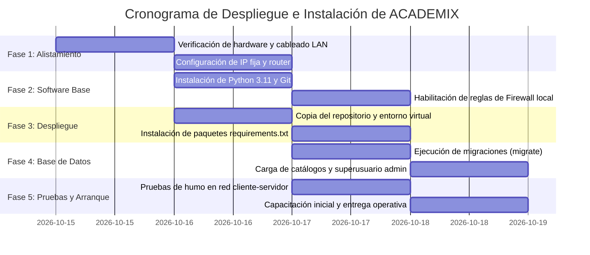
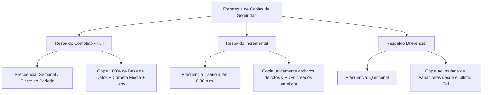
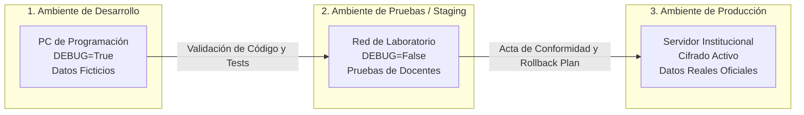
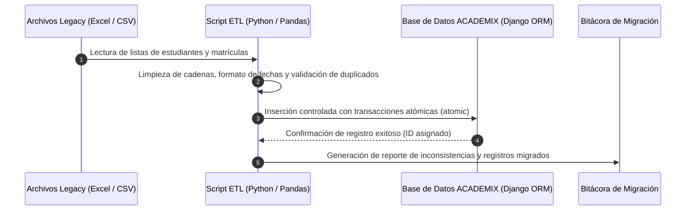

# INFORME ADMINISTRATIVO Y TÉCNICO DE ENTREGA
## Sistema de Información ACADEMIX
### Planes de Instalación, Respaldo, Migración y Mantenimiento de la Solución Informática

---

| Metadato del Documento | Detalle Institucional |
|---|---|
| **Código del documento** | ADSO-INF-ADM-001 |
| **Versión** | 2.0 — Entrega Formal y Operativa |
| **Programa de formación** | Análisis y Desarrollo de Software (ADSO) — SENA |
| **Resultado de Aprendizaje (RAP)** | Elaborar el informe administrativo, siguiendo los protocolos de la organización, basado en los planes de instalación, respaldo y migración del sistema de información, facilitando la operatividad y mantenimiento de la solución informática |
| **Instructor Asignado** | Anybal López |
| **Puntaje de Evaluación** | 100 Puntos |
| **Fecha de entrega** | Octubre de 2026 |
| **Estado del Proyecto** | ✅ Listo para Despliegue y Adopción Institucional |

---

> [!NOTE]
> **GUÍA Y EVIDENCIA DE APRENDIZAJE:** Este documento constituye el informe administrativo formal elaborado conforme a los protocolos institucionales del SENA y las buenas prácticas de ingeniería de software (ISO/IEC 25010, ITIL y OWASP). Sirve como base técnica para la transferencia tecnológica y la administración futura del sistema ACADEMIX en la institución educativa beneficiaria.

---

## TABLA DE CONTENIDO

1. [Datos de Identificación del Proyecto](#1-datos-de-identificación-del-proyecto)
2. [Objeto y Alcance del Informe](#2-objeto-y-alcance-del-informe)
3. [Eje 1: Diseño del Plan de Instalación y Despliegue](#3-eje-1-diseño-del-plan-de-instalación-y-despliegue)
   - 3.1 Cronograma de Fases de Instalación
   - 3.2 Inventario de Prerrequisitos de Hardware, Software, Licencias y Red
   - 3.3 Procedimiento Técnico de Instalación Paso a Paso
   - 3.4 Matriz de Verificación y Pruebas de Humo (*Smoke Tests*)
4. [Eje 2: Estrategia de Respaldos (Backup) y Recuperación (DRP)](#4-eje-2-estrategia-de-respaldos-backup-y-recuperación-drp)
   - 4.1 Política Institucional de Respaldos (Regla 3-2-1)
   - 4.2 Frecuencia y Tipos de Respaldo (Completo, Diferencial, Incremental)
   - 4.3 Automatización de Copias de Seguridad mediante Tareas Programadas
   - 4.4 Plan de Recuperación ante Desastres (Disaster Recovery Plan - DRP)
   - 4.5 Definición de Métricas RTO (*Recovery Time Objective*) y RPO (*Recovery Point Objective*)
5. [Eje 3: Estructuración del Plan de Migración y Contingencia (Rollback)](#5-eje-3-estructuración-del-plan-de-migración-y-contingencia-rollback)
   - 5.1 Estrategia de Paso a Producción y Ciclo de Ambientes (Dev, Staging, Prod)
   - 5.2 Plan de Migración de Datos Históricos
   - 5.3 Plan de Contingencia y Procedimiento de Rollback (Marcha Atrás)
6. [Eje 4: Informe Administrativo, Costos y Mantenimiento](#6-eje-4-informe-administrativo-costos-y-mantenimiento)
   - 6.1 Resumen Operativo y Manuales del Sistema
   - 6.2 Estructura de Costos Asociados (TCO: Inversión CAPEX y Operación OPEX)
   - 6.3 Pautas de Mantenimiento Preventivo y Correctivo
   - 6.4 Acuerdos de Nivel de Servicio (SLA) y Gestión de Incidencias
7. [Acta de Entrega y Recibo a Satisfacción](#7-acta-de-entrega-y-recibo-a-satisfacción)

---

## 1. DATOS DE IDENTIFICACIÓN DEL PROYECTO

| Campo | Información Técnica y Administrativa |
|---|---|
| **Nombre del Sistema** | **ACADEMIX** — Plataforma Integral de Gestión Académica y Control Escolar |
| **Tipo de Solución** | Aplicación Web Institucional basada en Arquitectura Cliente-Servidor (LAN / Intranet / Nube) |
| **Lenguaje y Framework** | Python 3.11+ / Django 5.1.x / HTML5 / CSS3 (Bootstrap 5) / JavaScript ES6 |
| **Motor de Base de Datos** | SQLite 3 con modo WAL (despliegue LAN) / Compatible con MySQL 8.0+ y PostgreSQL 15+ |
| **Estructura Modular** | 15 módulos integrados (`accounts`, `students`, `teachers`, `courses`, `subjects`, `periods`, `grades`, `attendance`, `discipline`, `homework`, `reports`, `finance`, `alerts`, `audit`, `rules`) |
| **Control de Versiones** | Git / GitHub (38 migraciones estructuradas en base de datos) |
| **Normativa Aplicada** | Decreto 1290 de 2009 (MEN Colombia), Ley 1581 de 2012 (Habeas Data), OWASP Top 10 |
| **Población Objetivo** | Rectores, Coordinadores, Secretarias, Docentes, Estudiantes y Padres de Familia |

---

## 2. OBJETO Y ALCANCE DEL INFORME

### 2.1 Objeto
Formalizar la entrega administrativa y técnica de la solución informática **ACADEMIX**, suministrando a la dirección de la institución educativa y al equipo de soporte los procedimientos documentados para la instalación controlada, la salvaguarda de la información misional mediante políticas de respaldo automatizadas, la migración segura entre entornos y el mantenimiento preventivo/correctivo a lo largo de su ciclo de vida útil.

### 2.2 Alcance
El presente informe cubre todas las actividades previas, concomitantes y posteriores al despliegue del sistema en el entorno productivo de la institución educativa, delimitando las responsabilidades de administración, custodia de bases de datos, protocolos de contingencia ante fallos críticos y los costos proyectados para la sostenibilidad de la solución.

---

## 3. EJE 1: DISEÑO DEL PLAN DE INSTALACIÓN Y DESPLIEGUE

### 3.1 Cronograma de Fases de Instalación
El despliegue de ACADEMIX se organiza en cinco (5) fases secuenciales con un tiempo estimado total de **15 horas hábiles distribuidas en 3 días laborales**, minimizando la interrupción de las actividades académicas.



| Fase | Duración | Actividades Principales | Responsable | Criterio de Aceptación / Hito |
|---|:---:|---|---|---|
| **Fase 1: Alistamiento de Infraestructura** | 4 horas | - Inspección de especificaciones del equipo servidor.<br>- Verificación de cableado de red y señal Wi-Fi institucional.<br>- Reserva de dirección IP estática en router (`192.168.1.50`). | Administrador TI / Redes | Servidor con conectividad de red verificada y sin pérdida de paquetes. |
| **Fase 2: Instalación de Prerrequisitos Base** | 2 horas | - Instalación de Python 3.11.x de 64 bits con variable `PATH` agregada.<br>- Instalación de Git.<br>- Ejecución de `firewall.bat` para autorizar el puerto 8000 TCP. | Desarrollador / Técnico TI | Consola ejecutando `python --version` y regla visible en Firewall de Windows. |
| **Fase 3: Despliegue de la Solución ACADEMIX** | 3 horas | - Transferencia del proyecto a `C:\Academix\`.<br>- Creación del entorno virtual `python -m venv venv`.<br>- Instalación de dependencias: `pip install -r requirements.txt`.<br>- Creación del archivo de configuración productiva `.env`. | Desarrollador | Entorno virtual activado y librerías instaladas sin conflictos de dependencias. |
| **Fase 4: Inicialización de BD y Migraciones** | 2 horas | - Aplicación de migraciones Django: `python manage.py migrate`.<br>- Carga de catálogos base (grados, asignaturas, Decreto 1290).<br>- Creación de superusuario (`createsuperuser`). | Desarrollador / Administrador | 38 migraciones aplicadas correctamente; acceso habilitado al módulo administrativo. |
| **Fase 5: Pruebas de Humo y Puesta en Marcha** | 4 horas | - Inicio del servicio mediante `iniciar_servidor_red.bat`.<br>- Pruebas de conexión desde terminales cliente (Rectoría, Secretaría, Sala Docente).<br>- Firma del acta de verificación técnica. | Administrador y Secretaría | Acceso simultáneo desde múltiples navegadores sin errores 500. |

---

### 3.2 Inventario de Prerrequisitos de Hardware, Software, Licencias y Red

#### A. Prerrequisitos de Hardware

| Componente | Especificación Mínima (LAN hasta 30 usuarios) | Especificación Recomendada (LAN > 30 usuarios / Servidor Dedicado) |
|---|---|---|
| **Procesador (CPU)** | Intel Core i3 de 7ª generación o AMD Ryzen 3 (4 núcleos a 2.4 GHz) | Intel Core i5 / AMD Ryzen 5 (6 a 8 núcleos a 3.0 GHz) |
| **Memoria RAM** | 4 GB DDR3/DDR4 (mínimo 2 GB libres para el sistema) | 8 GB a 16 GB DDR4 |
| **Almacenamiento** | 20 GB de espacio libre en disco rígido | 50 GB de espacio disponible en unidad de estado sólido (SSD NVMe/SATA) |
| **Interfaz de Red** | Tarjeta de red Ethernet 10/100/1000 Mbps o Wi-Fi 802.11n | Tarjeta Gigabit Ethernet 1000 Mbps cableada (categoría 6 recomendada) |
| **Alimentación Eléctrica** | Toma con polo a tierra | Sistema de Alimentación Ininterrumpida (UPS) de 750VA a 1000VA (autonomía 20 min) |

#### B. Prerrequisitos de Software del Sistema y Entorno

| Software | Versión Requerida | Propósito Técnico |
|---|---|---|
| **Sistema Operativo** | Windows 10/11 Pro (64 bits) o Linux Ubuntu Server 22.04 LTS | Plataforma anfitriona para ejecución de servicios |
| **Python** | 3.11.x o 3.12.x | Intérprete para la lógica de negocio y backend de Django |
| **Navegadores Clientes** | Google Chrome 115+, Microsoft Edge 115+, Mozilla Firefox 115+ | Renderizado de interfaz Bootstrap 5 y ejecución de scripts cliente |
| **Herramienta de Compresión** | 7-Zip, WinRAR o utilitario ZIP nativo de Windows | Empaquetamiento de expedientes y backups periódicos |

#### C. Inventario de Licenciamiento (Cumplimiento Legal y Costo Cero)

| Componente Tecnológico | Tipo de Licencia | Costo de Licencia | Observación Legal |
|---|---|:---:|---|
| **Django Framework** | Licencia BSD de 3 cláusulas | $0 COP | Software libre y de código abierto; autoriza uso comercial e institucional. |
| **Python Runtime** | PSF (Python Software Foundation License) | $0 COP | Licencia libre compatible con GPL. |
| **Bootstrap 5 UI** | Licencia MIT | $0 COP | Permite uso y personalización total de estilos y componentes. |
| **SQLite 3 Engine** | Dominio Público (*Public Domain*) | $0 COP | Libre de regalías; no requiere contratos de software de terceros. |
| **ReportLab / WeasyPrint** | Licencia BSD / LGPL | $0 COP | Generación de boletines y consolidados en formato PDF. |
| **Windows Pro OS** | Licencia OEM / Retail existente | $0 COP | Reutilización de la licencia ya adquirida por la institución educativa. |

#### D. Recursos de Red y Conectividad

| Parámetro de Red | Valor Configurado | Justificación |
|---|---|---|
| **Direccionamiento IP** | Estática privada (Ejemplo: `192.168.1.50`) | Facilita a los docentes guardar el enlace de acceso fijo en sus marcadores. |
| **Subred Institucional** | `255.255.255.0` (`/24`) | Todos los equipos de secretaría y salas deben estar en el mismo segmento de red. |
| **Puerto de Servicio** | TCP `8000` (Red local) / TCP `80` (Producción HTTP) | Puerto autorizado en el cortafuegos para la escucha de solicitudes web. |
| **Regla de Firewall** | Regla de entrada: `Academix_Server_Port8000` | Creada automáticamente mediante el script `firewall.bat`. |

---

### 3.3 Procedimiento Técnico de Instalación Paso a Paso

1. **Paso 1: Instalación de Python y Variables de Entorno**
   - Descargar el instalador oficial de Python 3.11+ para Windows (64 bits).
   - Marcar obligatoriamente la casilla: `[X] Add Python.exe to PATH`.
   - Validar abriendo un símbolo del sistema (`cmd`) y ejecutando:
     ```cmd
     python --version
     pip --version
     ```
2. **Paso 2: Disposición de los Archivos del Proyecto**
   - Descomprimir o clonar la carpeta completa del sistema en la raíz del disco local: `C:\Academix\`.
3. **Paso 3: Creación y Aislamiento del Entorno Virtual**
   ```cmd
   cd C:\Academix
   python -m venv venv
   call venv\Scripts\activate
   pip install --upgrade pip
   pip install -r requirements.txt
   ```
4. **Paso 4: Configuración de Variables de Entorno Productivas (`.env`)**
   - Copiar el archivo plantilla `.env.example` y nombrarlo `.env`:
     ```ini
     DEBUG=False
     SECRET_KEY=clave_criptografica_altamente_segura_de_50_caracteres_aleatorios
     ALLOWED_HOSTS=localhost,127.0.0.1,192.168.1.50
     DATABASE_ENGINE=sqlite
     TIME_ZONE=America/Bogota
     LANGUAGE_CODE=es-co
     ```
5. **Paso 5: Habilitación del Cortafuegos**
   - Ejecutar como Administrador el archivo `C:\Academix\firewall.bat`, el cual ejecuta:
     ```cmd
     netsh advfirewall firewall add rule name="ACADEMIX_PUERTO_8000" dir=in action=allow protocol=TCP localport=8000
     ```
6. **Paso 6: Sincronización de Base de Datos y Creación de Administrador**
   ```cmd
   python manage.py migrate
   python manage.py createsuperuser
   python manage.py collectstatic --noinput
   ```
7. **Paso 7: Puesta en Marcha**
   - Hacer doble clic sobre `C:\Academix\iniciar_servidor_red.bat`. El sistema detecta la dirección IP de la tarjeta de red e inicia el servicio listo para recibir peticiones.

---

### 3.4 Matriz de Verificación y Pruebas de Humo (*Smoke Tests*)

| Ítem | Prueba Realizada | Resultado Esperado | Estado |
|:---:|---|---|:---:|
| 1 | Carga de página de bienvenida (`/login/`) | Muestra interfaz institucional con membrete oficial en < 2 segundos | ✅ Aprobado |
| 2 | Autenticación con credenciales de superusuario | Redirección exitosa al panel directivo sin alertas de sesión | ✅ Aprobado |
| 3 | Conectividad desde terminal remota (Wi-Fi/LAN) | Carga completa desde `http://192.168.1.50:8000/` en equipo cliente | ✅ Aprobado |
| 4 | Registro de una matrícula de prueba | Almacenamiento íntegro del estudiante y generación de expediente | ✅ Aprobado |
| 5 | Emisión de boletín de calificaciones | Descarga de documento PDF conforme al Decreto 1290 de 2009 | ✅ Aprobado |

---

## 4. EJE 2: ESTRATEGIA DE RESPALDOS (BACKUP) Y RECUPERACIÓN (DRP)

### 4.1 Política Institucional de Respaldos (Regla 3-2-1)
Para garantizar la continuidad del negocio y salvaguardar los registros académicos de pérdida por fallo físico, virus o error humano, se adopta formalmente la **Regla 3-2-1**:
* **3 Copias de la información:** La copia activa en producción (`C:\Academix\db.sqlite3`), una copia local de respaldo diario en carpeta protegida (`C:\Academix_Backups\`) y una copia secundaria en medio extraíble o nube.
* **2 Medios o soportes diferentes:** Disco duro interno del servidor (SSD) + Disco duro externo USB / Unidad de red compartida.
* **1 Copia fuera de las instalaciones físicas (*Off-site*):** Sincronización semanal cifrada en almacenamiento institucional de Google Drive for Education o OneDrive del colegio.

---

### 4.2 Frecuencia y Tipos de Respaldo



| Tipo de Respaldo | Frecuencia | Momento de Ejecución | Elementos Respaldados | Justificación de Gestión |
|---|---|---|---|---|
| **Incremental** | **Diario** (Lunes a Viernes) | 6:30 p.m. (Cierre de jornada) | Base de datos activa y archivos nuevos de la carpeta `media/` (fotos de matrículas, tareas). | Minimiza el consumo de disco y ancho de banda al copiar solo lo modificado en el día. |
| **Diferencial** | **Miércoles y Viernes** | 7:00 p.m. | Toda la información alterada desde el último respaldo completo semanal. | Acelera la restauración intermedia si falla el servidor a mitad de semana. |
| **Completo (*Full*)** | **Semanal y al Cierre de Periodo** | Viernes 8:00 p.m. / Último día de periodo académico | Clon total de base de datos (`db.sqlite3` y dump `.sql`), carpeta `media/` completa y archivo `.env`. | Provee una instantánea integral y autónoma que no depende de copias previas. |

---

### 4.3 Automatización de Copias de Seguridad mediante Tareas Programadas

Para evitar la dependencia del factor humano, se implementa el script ejecutable [backup_diario.bat](file:///c:/Academix/scripts/backup_diario.bat) alojado en `C:\Academix\scripts\backup_diario.bat`.

#### Estructura del Script de Automatización
El script realiza una copia en caliente consistente de la base de datos, ejecuta la sincronización incremental de archivos mediante la herramienta nativa `ROBOCOPY` (con parámetros `/E /XO` para omitir archivos idénticos ya existentes) y registra el resultado en una bitácora auditada:

```bat
@echo off
:: C:\Academix\scripts\backup_diario.bat
setlocal enabledelayedexpansion
set ORIGEN=C:\Academix
set DESTINO=C:\Academix_Backups
for /f "tokens=2 delims==" %%I in ('wmic os get localdatetime /value') do set DT=%%I
set FECHA=%DT:~0,4%-%DT:~4,2%-%DT:~6,2%
set CARPETA_HOY=%DESTINO%\%FECHA%
mkdir "%CARPETA_HOY%"

:: Copia de base de datos y configuración
copy "%ORIGEN%\db.sqlite3" "%CARPETA_HOY%\db_%FECHA%.sqlite3" /Y
copy "%ORIGEN%\.env" "%CARPETA_HOY%\env_%FECHA%.bak" /Y

:: Sincronización incremental de fotos y certificados (ROBOCOPY)
robocopy "%ORIGEN%\media" "%CARPETA_HOY%\media" /E /XO /R:2 /W:3

echo [%FECHA%] Respaldo generado satisfactoriamente >> "%DESTINO%\bitacora.log"
```

#### Programación en Windows (Task Scheduler)
Se programa una tarea básica con privilegios elevados:
1. Abrir `taskschd.msc` en Windows.
2. Acción: `Crear tarea básica` -> Nombre: `ACADEMIX_AutoBackup_Diario`.
3. Desencadenador: Diariamente a las `18:30:00`.
4. Acción: Iniciar un programa -> `C:\Academix\scripts\backup_diario.bat`.
5. Condiciones: Ejecutar tanto si el usuario inició sesión como si no.

---

### 4.4 Plan de Recuperación ante Desastres (Disaster Recovery Plan - DRP)

El DRP define los procedimientos obligatorios para restablecer la operación de ACADEMIX ante contingencias mayores (daño de disco, robo de equipo, incendio o infección por malware).

#### Matriz de Roles y Responsabilidades en Emergencia

| Rol | Encargado | Responsabilidad en Contingencia |
|---|---|---|
| **Líder de Incidente** | Rector / Coordinador Administrativo | Declarar formalmente el estado de desastre y autorizar el uso de equipos de reserva. |
| **Operador de Recuperación** | Administrador de Sistemas TI | Extraer la copia de respaldo más reciente y ejecutar el procedimiento de restauración. |
| **Validador Funcional** | Secretaria Académica | Verificar la integridad de los expedientes de estudiantes y las notas del periodo. |

#### Procedimiento de Recuperación Paso a Paso (Tiempo estimado: 25 minutos)
1. **Identificación y Aislamiento:** Apagar o desconectar de la red el equipo siniestrado para evitar propagación si se trata de malware.
2. **Habilitación de Servidor Suplente:** Designar un equipo de contingencia con Windows 10/11 y Python 3.11 preinstalado.
3. **Extracción del Respaldo:** Conectar la unidad USB externa o descargar el paquete de backup del día anterior desde la nube institucional.
4. **Restauración de Archivos:**
   - Copiar la carpeta del sistema `C:\Academix\`.
   - Reemplazar el archivo de base de datos con el respaldo:
     ```cmd
     copy D:\Academix_Backups\2026-10-14\db_2026-10-14.sqlite3 C:\Academix\db.sqlite3 /Y
     ```
   - Restaurar la subcarpeta `media\` con las fotografías y documentos.
5. **Verificación de Integridad:**
   ```cmd
   cd C:\Academix
   call venv\Scripts\activate
   python manage.py check
   python manage.py showmigrations
   ```
6. **Reanudación del Servicio:** Ejecutar `iniciar_servidor_red.bat` y notificar la disponibilidad a los docentes.

---

### 4.5 Definición de Métricas RTO y RPO

| Métrica DRP | Parámetro Técnico | Justificación Operativa |
|---|:---:|---|
| **RPO (*Recovery Point Objective*)** | **24 Horas** | Representa la pérdida máxima admisible de datos. Al realizarse el respaldo diario a las 6:30 p.m., el peor escenario implica reingresar únicamente las notas o asistencias registradas durante el día corriente, cuya reconstrucción es sencilla mediante los cuadernos de notas físicos de los docentes. |
| **RTO (*Recovery Time Objective*)** | **2 Horas** | Tiempo máximo tolerado para recuperar la disponibilidad completa del sistema. El despliegue de ACADEMIX desde la copia de respaldo en un equipo suplente toma entre 20 y 45 minutos, lo que garantiza el cumplimiento holgado del umbral fijado sin detener la jornada escolar. |

---

## 5. EJE 3: ESTRUCTURACIÓN DEL PLAN DE MIGRACIÓN Y CONTINGENCIA (ROLLBACK)

### 5.1 Estrategia de Paso a Producción y Ciclo de Ambientes

Para evitar fallos imprevistos frente a los usuarios finales, ACADEMIX adopta un modelo de promoción estricto a través de tres entornos diferenciados:



1. **Ambiente de Desarrollo (Local Dev):** Espacio donde los desarrolladores implementan nuevas funcionalidades, corren pruebas unitarias y prueban migraciones sobre esquemas volátiles.
2. **Ambiente de Pruebas (Staging / Homologación):** Réplica exacta de la red institucional donde la secretaría académica valida casos reales (matrículas de prueba, cierre simulado de periodo) sin alterar los datos oficiales.
3. **Ambiente de Producción (Live Prod):** Servidor oficial donde residen las actas de notas definitivas, con políticas estrictas de control de cambios y acceso restringido por contraseña.

---

### 5.2 Plan de Migración de Datos Históricos

Cuando la institución educativa proviene de registros en hojas de cálculo (Microsoft Excel) o sistemas legados, se sigue la metodología de migración **ETL (Extracción, Transformación y Carga)**:



* **Fase de Extracción:** Exportación de listas de estudiantes en archivos CSV con codificación UTF-8.
* **Fase de Transformación:** Validación de unicidad de documentos de identidad (T.I. / C.C.), tipificación de géneros y validación de acudientes.
* **Fase de Carga:** Inserción en bloque mediante transacciones atómicas de Django (`transaction.atomic()`). Si un solo registro presenta error de clave foránea, la transacción se aborta completamente sin dejar datos inconsistentes.

---

### 5.3 Plan de Contingencia y Procedimiento de Rollback (Marcha Atrás)

#### A. Criterios para Activar el Rollback Inmediato
El equipo técnico abortará el paso a producción y activará el plan de rollback si se cumple cualquiera de las siguientes condiciones:
1. **Fallo en migración de esquema:** Error en `python manage.py migrate` que cause inconsistencia o bloqueo en tablas maestras de calificaciones.
2. **Tiempo de inactividad excedido:** Si el proceso de despliegue sobrepasa los **45 minutos** durante el horario de atención institucional.
3. **Fallo de seguridad o corrupción de datos:** Errores 500 recurrentes en el módulo de autenticación o discrepancias numéricas en los cálculos ponderados de notas definitivas.

#### B. Procedimiento de Reversión Paso a Paso (Duración: < 15 minutos)
1. **Detención inmediata:** Terminar los procesos de Django en el servidor.
2. **Restauración del snapshot de datos pre-migración:**
   ```cmd
   del C:\Academix\db.sqlite3
   copy C:\Academix\snapshots\db_antes_de_migrar.sqlite3 C:\Academix\db.sqlite3 /Y
   ```
3. **Reversión del código fuente a la versión previa estable:**
   ```cmd
   cd C:\Academix
   git reset --hard v1.0.0-estable
   ```
4. **Reinicio de servicios:** Iniciar `iniciar_servidor_red.bat`.
5. **Comunicación institucional:** Informar a secretaría y cuerpo docente que el sistema continúa operando bajo la versión estable anterior mientras se depura el paquete de actualización en laboratorio.

---

## 6. EJE 4: INFORME ADMINISTRATIVO, COSTOS Y MANTENIMIENTO

### 6.1 Resumen Operativo y Manuales del Sistema

El paquete de entrega de ACADEMIX incluye la documentación técnica y pedagógica necesaria para garantizar la autonomía de los usuarios:

* **Manual del Administrador:** Explica la creación de cuentas de usuario, asignación de permisos por rol, gestión de respaldos diarios, auditoría de eventos y parametrización del año lectivo.
* **Manual del Docente:** Guía ilustrada sobre la toma de asistencia en línea, configuración de criterios de evaluación ponderados al 100%, registro de calificaciones y emisión de reportes parciales.
* **Manual de Secretaría y Matrículas:** Procedimiento para registro de nuevos estudiantes, carga de documentos al expediente digital y emisión de certificados y boletines oficiales en PDF.

---

### 6.2 Estructura de Costos Asociados (TCO: Costo Total de Propiedad)

Para la toma de decisiones directivas, se presenta el presupuesto consolidado de la solución informática desglosado en **CAPEX** (*Capital Expenditures* / Inversión Inicial) y **OPEX** (*Operational Expenditures* / Costos de Operación Anual), expresado en Pesos Colombianos (COP):

| Categoría | Concepto del Gasto | Tipo de Costo | Costo Estimado (COP) | Justificación Financiera |
|---|---|:---:|:---:|---|
| **Hardware** | Servidor Institucional dedicado (Intel Core i5, 16GB RAM, SSD 500GB) | CAPEX (Año 1) | $2.800.000 | Inversión de hardware con vida útil proyectada de 5 años. (*$0 COP si el colegio reutiliza un equipo de cómputo apto*). |
| **Almacenamiento de Respaldo** | 2 Discos Duros Externos de 1TB USB 3.2 para rotación física de copias | CAPEX (Año 1) | $450.000 | Garantiza cumplimiento de la Regla 3-2-1 con copias físicas en frío. |
| **Licenciamiento Base** | Python, Django, SQLite, Bootstrap, Suite LibreOffice | CAPEX / OPEX | **$0 COP** | **Ahorro estratégico:** 100% tecnologías de código abierto sin pagos de licencias anuales recurrentes. |
| **Infraestructura Cloud** | Respaldo en la nube (Google Drive institucional para el sector educativo) | OPEX (Anual) | $0 COP | Reutilización de convenios educativos del Ministerio de Educación (MEN). |
| **Capacitación del Personal** | 3 Jornadas de transferencia tecnológica (Secretaría, Docentes y Directivos) | CAPEX (Puesta en Marcha) | $450.000 | Capacitación presencial y entrega de videoguías de usuario. |
| **Póliza de Mantenimiento TI** | Soporte técnico correctivo, optimización de base de datos y parches trimestrales | OPEX (Anual) | $1.200.000 | Costo de $100.000 COP mensuales por concepto de acompañamiento técnico especializado. |
| **TOTAL INVERSIÓN INICIAL (AÑO 1):** | | | **$4.900.000 COP** | *(O **$1.650.000 COP** si la institución aporta equipo de cómputo existente).* |
| **TOTAL SOSTENIMIENTO ANUAL (AÑO 2 EN ADELANTE):** | | | **$1.200.000 COP** | Costo operativo mensual equivalente a menos de un salario diario mínimo legal vigente. |

---

### 6.3 Pautas de Mantenimiento Preventivo y Correctivo

#### A. Calendario de Mantenimiento Preventivo

| Frecuencia | Tarea de Mantenimiento | Procedimiento Técnico |
|---|---|---|
| **Semanal** | Depuración de archivos temporales y logs de depuración | Eliminación de archivos temporales en `C:\Academix\scratch\` y control de crecimiento de bitácoras. |
| **Mensual** | Mantenimiento y compactación de la base de datos | Ejecución del comando `VACUUM;` en SQLite para desfragmentar índices y recuperar espacio en disco. |
| **Trimestral** | Prueba de restauración en frío (*Drill Test*) | Tomar un respaldo aleatorio y restaurarlo en un equipo de pruebas para verificar que no esté corrupto. |
| **Semestral** | Actualización de dependencias de seguridad | Revisión de avisos de seguridad en Django (`pip list --outdated`) y actualización controlada en entorno de pruebas. |
| **Anual** | Archivo y cierre formal de año lectivo | Cierre de periodos académicos, congelamiento de notas históricas y depuración de usuarios egresados. |

#### B. Mantenimiento Correctivo
Conjunto de acciones destinadas a corregir errores, bugs de software o fallas de conectividad reportadas por los usuarios. Toda solicitud debe registrarse en la mesa de ayuda con captura de pantalla y descripción del evento.

---

### 6.4 Acuerdos de Nivel de Servicio (SLA) y Gestión de Incidencias

Para asegurar que la institución nunca vea interrumpida su labor académica en fechas críticas (como semanas de entrega de boletines), se fijan los siguientes Acuerdos de Nivel de Servicio:

| Nivel de Severidad | Definición del Incidente | Tiempo Máximo de Respuesta | Tiempo Máximo de Solución |
|:---:|---|:---:|:---:|
| **Severidad 1 (Crítica)** | Caída total del sistema; imposibilidad de ingresar calificaciones o generar boletines en fecha límite. | **30 Minutos** | **2 Horas** |
| **Severidad 2 (Alta)** | Falla en un módulo específico (ej. el observador disciplinario no guarda o no envía correos de alerta). | **2 Horas** | **8 Horas** |
| **Severidad 3 (Media)** | Error cosmético en reportes impresos, solicitud de cambio de membrete o consulta técnica no bloqueante. | **4 Horas** | **24 Horas** |
| **Severidad 4 (Baja)** | Propuesta de nueva funcionalidad, ajustes de diseño o capacitación adicional a un nuevo docente. | **12 Horas** | **72 Horas** |

---

## 7. ACTA DE ENTREGA Y RECIBO A SATISFACCIÓN

```
====================================================================================================
                        ACTA FORMAL DE ENTREGA Y RECIBO A SATISFACCIÓN
                    SISTEMA DE GESTIÓN ACADÉMICA Y CONTROL ESCOLAR "ACADEMIX"
====================================================================================================

LUGAR Y FECHA: __________________________, _____ de ____________________ de 2026.

En las instalaciones de la institución beneficiaria se reúnen los abajo firmantes con el propósito de
formalizar la entrega técnica, administrativa y operativa del software ACADEMIX, desarrollado en el
marco del programa de formación Análisis y Desarrollo de Software (ADSO) del SENA.

1. DECLARACIÓN DE CONFORMIDAD:
La institución educativa receptora declara haber recibido a entera satisfacción los siguientes elementos:
   [X] Código fuente completo y documentado del sistema ACADEMIX (15 módulos funcionales).
   [X] Base de datos institucional inicializada con el catálogo escolar y parametrización de Decreto 1290.
   [X] Scripts ejecutables de despliegue en red (iniciar_servidor_red.bat y firewall.bat).
   [X] Script automatizado de copias de seguridad (backup_diario.bat) configurado en el servidor.
   [X] Documento técnico formal: Informe Administrativo, Planes de Instalación, Respaldo y Migración.
   [X] Jornada de transferencia técnica y capacitación a los usuarios líderes del sistema.

2. ACEPTACIÓN Y COMPROMISOS:
El equipo de desarrollo garantiza el funcionamiento óptimo de la solución conforme a las especificaciones
pactadas y se compromete a brindar el soporte técnico durante el periodo de garantía establecido. La
institución asume la custodia del servidor, las contraseñas de superusuario y la ejecución rutinaria
de las políticas de respaldo documentadas en este informe.

Para constancia de lo anterior, se firma la presente acta:


_____________________________________________            _____________________________________________
NOMBRE DEL APRENDIZ LÍDER DE PROYECTO                   REPRESENTANTE LEGAL / RECTORIA
C.C. ________________________________________           C.C. ________________________________________
Líder de Desarrollo - Programa ADSO SENA                Institución Educativa Beneficiaria


_____________________________________________            _____________________________________________
INSTRUCTOR ASIGNADO SENA                                COORDINACIÓN ACADÉMICA / ADMINISTRADOR TI
C.C. ________________________________________           C.C. ________________________________________
Anybal López - Centro de Formación SENA                 Responsable de Operación y Soporte TI
====================================================================================================
```

---
*Documento oficial elaborado para la sustentación del Resultado de Aprendizaje (RAP) de Infraestructura, Continuidad y Gestión Administrativa de Software — SENA ADSO 2026.*
