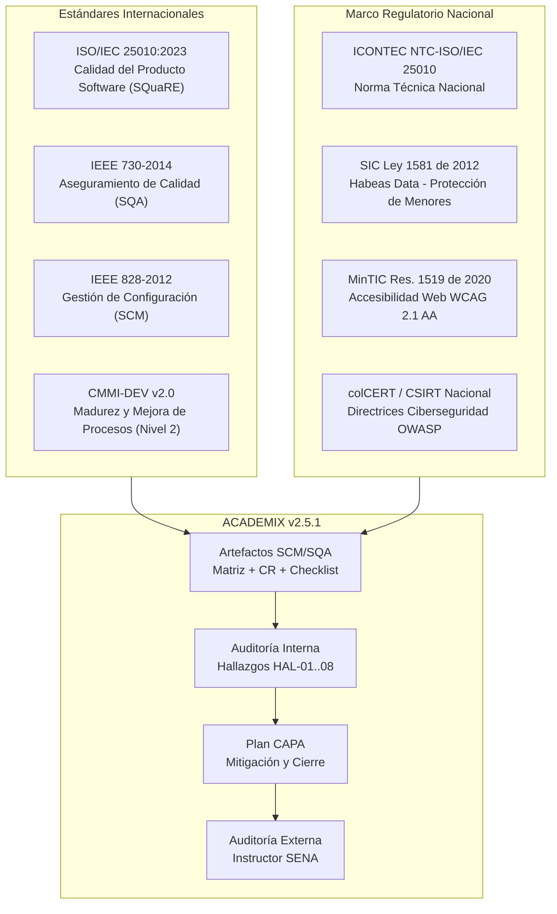

# INFORME FINAL DEL PROCESO DE GESTIÓN DE CALIDAD EN EL DESARROLLO DE SOFTWARE
## Consolidación Integral de Evidencias, Hallazgos, Novedades de Seguimiento y Control de Productos bajo Normas Internacionales (ISO/IEC 25010, IEEE 730, IEEE 828, CMMI-DEV) y Protocolos Organizacionales
### Proyecto Formativo: Plataforma Web de Gestión Académica y Control Escolar ACADEMIX v2.5.1

---

**Programa de Formación:** Tecnología en Análisis y Desarrollo de Software (ADSO)  
**Institución:** Servicio Nacional de Aprendizaje (SENA) — Centro de Formación en Tecnologías de la Información  
**Ficha de Caracterización:** 3173430  
**Competencia Laboral:** 220501096 — Desarrollar el sistema informático según requisitos y diseño tecnológico  
**Resultado de Aprendizaje:** Gestionar la calidad del software en desarrollo mediante la aplicación de estándares, métricas, auditorías y control de configuración  
**Empresa / Equipo Desarrollador:** Academix Software Solutions — Equipo Formativo ADSO  
**Líder de Calidad y SQA:** Sofia Helena Torres (Aprendiz ADSO)  
**Líder Técnico y Arquitectura (CCB):** Julián Esteban Rocha (Aprendiz ADSO)  
**Líder de Datos y Pruebas UX:** David Camilo Morales (Aprendiz ADSO)  
**Evaluador / Auditor Externo:** Instructor Técnico SENA — Área de Teleinformática y Desarrollo  
**Fecha de Publicación Oficial:** Noviembre de 2026  
**Línea Base Evaluada:** Commit `d97d7a6` (Tag `v2.5.0-baseline`) $\rightarrow$ Cierre y Congelamiento en `f4b82e1` (Tag `v2.5.1-baseline`)  
**Estado del Dictamen:** **CONFORME SATISFACTORIO — SISTEMA APTO Y PREPARADO PARA AUDITORÍA EXTERNA**  

---

## TABLA DE CONTENIDO DETALLADA

1. [Presentación Institucional y Ficha Técnica del Proyecto](#1-presentación-institucional-y-ficha-técnica-del-proyecto)
2. [Objetivos de la Gestión de Calidad](#2-objetivos-de-la-gestión-de-calidad)
   - 2.1 Objetivo General
   - 2.2 Objetivos Específicos
   - 2.3 Alcance Operativo y Delimitación de Componentes
3. [Marco Normativo Internacional y Regulación Colombiana](#3-marco-normativo-internacional-y-regulación-colombiana)
   - 3.1 Modelo de Calidad del Producto (ISO/IEC 25010:2023 / SQuaRE)
   - 3.2 Aseguramiento de Calidad del Software SQA (IEEE 730-2014)
   - 3.3 Gestión de la Configuración del Software SCM (IEEE 828-2012 y CMMI-DEV v2.0)
   - 3.4 Marco Normativo y Obligaciones Legales en Colombia (ICONTEC, MinTIC, SIC Ley 1581)
4. [Artefactos y Plantillas de Control de Calidad Diligenciados](#4-artefactos-y-plantillas-de-control-de-calidad-diligenciados)
   - 4.1 Artefacto 1: Matriz de Evaluación de Calidad ISO/IEC 25010
   - 4.2 Artefacto 2: Formato Formal de Solicitud de Cambio (Change Request - SCM)
   - 4.3 Artefacto 3: Lista de Verificación (Checklist) de Revisiones de Código Pre-Merge
5. [Seguimiento, Control y Novedades del Producto (Fase Práctica SCM)](#5-seguimiento-control-y-novedades-del-producto-fase-práctica-scm)
   - 5.1 Autoevaluación del Módulo Nuclear: `apps.accounts`
   - 5.2 Simulación del Cambio y Trazabilidad en Repositorio Git
   - 5.3 Líneas Base y Contabilidad del Estado de la Configuración (CSA)
6. [Auditoría Interna de Calidad: Inspección, Pruebas y Evidencias](#6-auditoría-interna-de-calidad-inspección-pruebas-y-evidencias)
   - 6.1 Metodología de Auditoría e Instrumentos Utilizados
   - 6.2 Resultados de Inspección por Módulos Funcionales
   - 6.3 Matriz Consolidada de Hallazgos (Findings)
   - 6.4 Análisis de Causa Raíz (Diagrama de Ishikawa y Técnica de los 5 Porqués)
7. [Plan de Acciones Correctivas y Preventivas (CAPA — IEEE 730)](#7-plan-de-acciones-correctivas-y-preventivas-capa--ieee-730)
   - 7.1 Consolidado de Acciones Implementadas
   - 7.2 Verificación de Efectividad y Cierre de Brechas
8. [Preparación para la Auditoría Externa del Instructor SENA](#8-preparación-para-la-auditoría-externa-del-instructor-sena)
   - 8.1 Banco de Preguntas Técnicas y Respuestas Fundamentadas
   - 8.2 Inventario Oficial de Evidencias Verificables
9. [Dictamen Final de Calidad y Conclusiones de la Organización](#9-dictamen-final-de-calidad-y-conclusiones-de-la-organización)
10. [Referencias Bibliográficas (Normas APA 7.ª Edición)](#10-referencias-bibliográficas-normas-apa-7ª-edición)

---

# 1. PRESENTACIÓN INSTITUCIONAL Y FICHA TÉCNICA DEL PROYECTO

El presente documento constituye el **Informe Final Consolidado del Proceso de Gestión de Calidad en el Desarrollo de Software**, elaborado como evidencia formativa de cierre en el marco del programa de Tecnología en Análisis y Desarrollo de Software (ADSO) del SENA. Reúne, sistematiza y articula la investigación teórica, los artefactos documentales obligatorios, la autoevaluación práctica sobre el código fuente, la auditoría interna de calidad con su matriz de hallazgos, y la gestión de configuración del software aplicada a la plataforma **ACADEMIX**.

```
+----------------------------------------------------------------------------------------------------+
|                         FICHA TÉCNICA DE GESTIÓN DE CALIDAD Y AUDITORÍA                            |
|                                       EMPRESA: ACADEMIX                                            |
+----------------------------------------------------------------------------------------------------+
```

| Campo | Especificación Técnica Institucional |
| :--- | :--- |
| **Nombre del Producto Software:** | ACADEMIX — Sistema Web de Gestión Académica, Matrícula y Control Escolar |
| **Versión Auditada y Congelada:** | Versión 2.5.1 (Línea Base: `v2.5.1-baseline`, commit `f4b82e1`) |
| **Lenguaje y Entorno:** | Python 3.14 / Django Framework 5.x |
| **Arquitectura del Sistema:** | Modelo-Vista-Template (MVT) desacoplado, modular en 15 aplicaciones Django |
| **Bases de Datos:** | PostgreSQL 16 (Entorno Producción Render Cloud) / SQLite 3 (Entorno Local Staging) |
| **Frontend y UI:** | HTML5 semántico, Bootstrap 5.3, Tailwind CSS, JavaScript Vanilla y HTMX |
| **Repositorio y Control de Versiones:** | Git / GitHub institucional bajo modelo de flujo de trabajo GitFlow adaptado |
| **Módulos Evaluados:** | `apps.accounts`, `apps.students`, `apps.grades`, `apps.reports`, `apps.audit`, `apps.periods` |
| **Comité de Control de Cambios (CCB):** | Julián Rocha (Líder Técnico) y Sofia Torres (Líder SQA) |
| **Tipo de Auditoría:** | Auditoría Interna de Primera Parte preparatoria para Evaluación Externa SENA |

---

# 2. OBJETIVOS DE LA GESTIÓN DE CALIDAD

## 2.1 Objetivo General
Consolidar el proceso integral de aseguramiento de calidad (SQA) y gestión de configuración (SCM) aplicado a la plataforma web ACADEMIX, verificando la conformidad del producto frente a la norma **ISO/IEC 25010:2023**, los procesos de **IEEE 730**, las directrices de configuración de **IEEE 828**, el modelo **CMMI-DEV v2.0** y el marco normativo colombiano (Ley 1581/2012 y Res. 1519/2020 MinTIC), documentando evidencias, hallazgos, planes de acción correctiva (CAPA) y preparando al equipo para la auditoría externa del instructor técnico.

## 2.2 Objetivos Específicos
1. **Investigar y Formalizar el Marco Conceptual:** Estructurar los principios rectores de ISO/IEC 25010, IEEE 730, IEEE 828, CMMI y la regulación colombiana sobre seguridad de datos y accesibilidad web.
2. **Implementar los Artefactos Documentales Obligatorios:** Diseñar y diligenciar completamente la Matriz de Calidad, el Formato de Solicitud de Cambio (Change Request) y la Lista de Verificación (Checklist) de Revisiones de Código.
3. **Ejecutar la Autoevaluación Práctica:** Medir cuantitativamente el comportamiento del módulo nuclear de autenticación (`apps.accounts`), registrando métricas reales de rendimiento, seguridad y accesibilidad.
4. **Demostrar el Control de Configuración y Líneas Base:** Simular la gestión de cambios mediante ramas Git, Pull Requests formales e inspección previa al Merge, consolidando las líneas base `v2.5.0-baseline` y `v2.5.1-baseline`.
5. **Ejecutar la Auditoría Interna y el Plan CAPA:** Identificar y clasificar los hallazgos en No Conformidades Mayores, Menores y Oportunidades de Mejora, aplicando análisis de causa raíz (Ishikawa y 5 Porqués) y ejecutando acciones correctivas inmediatas.
6. **Estructurar la Defensa Técnica Externa:** Diseñar el banco de preguntas y respuestas técnicas tipo auditoría externa y consolidar el inventario de evidencias para la evaluación presencial del instructor.

## 2.3 Alcance Operativo y Delimitación de Componentes
El alcance de la gestión de calidad abarca:
- **Seguridad Perimetral y de Aplicación:** Mecanismos de autenticación, hash de contraseñas, control de acceso basado en roles (RBAC: Rector, Coordinador, Docente, Estudiante, Acudiente), mitigación de ataques de fuerza bruta y trazabilidad en logs.
- **Integridad de Datos y Transacciones:** Validación de cargas masivas de estudiantes (`apps.students`) con bloques atómicos ACID, cálculo ponderado de notas RAPs al 100% (`apps.grades`) y consistencia en el bloqueo de periodos lectivos (`apps.periods`).
- **Verificación Documental Oficial:** Emisión de boletines escolares en PDF con firma digital y verificación mediante código QR dinámico criptográfico (`apps.reports`).
- **Accesibilidad y Usabilidad Web:** Interfaces de usuario evaluadas bajo las directrices W3C WCAG 2.1 nivel AA y la Resolución 1519 de 2020 de MinTIC.

---

# 3. MARCO NORMATIVO INTERNACIONAL Y REGULACIÓN COLOMBIANA



## 3.1 Modelo de Calidad del Producto (ISO/IEC 25010:2023 / SQuaRE)
La norma ISO/IEC 25010, parte de la serie SQuaRE (*Systems and software Quality Requirements and Evaluation*), establece un marco estructurado en ocho características de calidad para evaluar productos de software:

1. **Adecuación Funcional:** Grado en que el software provee funciones que satisfacen las necesidades declaradas e implícitas (Completitud, Corrección y Pertinencia).
2. **Eficiencia de Desempeño:** Rendimiento relativo a la cantidad de recursos utilizados bajo condiciones determinadas (Comportamiento temporal, Utilización de recursos, Capacidad).
3. **Compatibilidad:** Capacidad de intercambiar información y compartir entornos sin interferencias (Coexistencia e Interoperabilidad).
4. **Usabilidad:** Facilidad con que los usuarios interactúan y alcanzan objetivos con eficacia y satisfacción (Reconocibilidad, Aprendizabilidad, Operabilidad, Protección contra errores de usuario, Estética de UI, **Accesibilidad**).
5. **Fiabilidad:** Habilidad de un sistema para mantener su nivel de servicio bajo condiciones normales y anómalas (Madurez, Disponibilidad, Tolerancia a fallos, Capacidad de recuperación).
6. **Seguridad:** Protección de la información y los datos para que personas o sistemas no autorizados no puedan leerlos ni modificarlos (Confidencialidad, Integridad, No repudio, Responsabilidad/Trazabilidad, Autenticidad).
7. **Mantenibilidad:** Eficacia y eficiencia con que el software puede ser modificado por los desarrolladores (Modularidad, Reusabilidad, Analizabilidad, Modificabilidad, Facilidad de prueba).
8. **Portabilidad:** Facilidad para transferir el sistema de un entorno de hardware, software u operativo a otro (Adaptabilidad, Facilidad de instalación, Capacidad de sustitución).

Para ACADEMIX, se seleccionaron como prioritarias: **Seguridad**, **Fiabilidad**, **Usabilidad** y **Mantenibilidad**, dado su impacto directo en el manejo de expedientes académicos y datos personales de menores.

## 3.2 Aseguramiento de Calidad del Software SQA (IEEE 730-2014)
El estándar **IEEE 730** define que el Aseguramiento de Calidad (SQA) es un conjunto planificado y sistemático de acciones orientadas a proporcionar la confianza de que el software cumple con los requerimientos técnicos y estándares establecidos.
- **SQA Preventivo vs. Testing Reactivo:** Mientras las pruebas tradicionales se enfocan en identificar fallos en el código compilado, el SQA interviene preventivamente en todas las fases del ciclo de vida, estableciendo guías de codificación (PEP 8), revisiones por pares, listas de chequeo en Pull Requests y auditorías de proceso.
- **Secciones Obligatorias del Plan SQAP:** Propósito y alcance, documentos de referencia, estructura de gestión del SQA, documentación y artefactos, estándares y métricas, revisiones formales, pruebas y verificación, reporte de problemas, herramientas y gestión de riesgos técnicos.

## 3.3 Gestión de la Configuración del Software SCM (IEEE 828-2012 y CMMI-DEV v2.0)
El estándar **IEEE 828** regula la gestión de configuración en cinco procesos fundamentales:
1. **Identificación de la Configuración:** Identificación formal de los Ítems de Configuración (CIs): código fuente (`apps/`), esquemas de base de datos (`migrations/`), configuraciones (`settings.py`, `.env.example`), librerías (`requirements.txt`) y documentación técnica.
2. **Control de Cambios:** Procedimiento formal para proponer, evaluar, autorizar e implementar modificaciones mediante Solicitudes de Cambio (CR) sometidas al Comité de Control de Cambios (CCB).
3. **Contabilidad del Estado de Configuración (CSA):** Registro trazable que documenta en qué versión, commit o rama se encuentra cada artefacto del sistema en los entornos de desarrollo, pruebas y producción.
4. **Auditorías de Configuración:** Auditoría Funcional (FCA: verificación de requisitos) y Auditoría Física (PCA: correspondencia exacta entre código aprobado e instalado en producción).
5. **Gestión de Releases:** Publicación controlada de versiones congeladas mediante etiquetas Git semánticas.

Bajo el modelo **CMMI-DEV v2.0**, el área de práctica de Gestión de Configuración (CM) exige tres objetivos específicos:
- **SG 1 (Establecer Baselines):** Creación de líneas base formales que sirvan como punto de partida inmutable.
- **SG 2 (Seguir y Controlar Cambios):** Registro estructurado de cada cambio mediante formatos de aprobación formal.
- **SG 3 (Establecer Integridad):** Garantía de que los artefactos en producción corresponden a los aprobados sin modificaciones ilícitas.

## 3.4 Marco Normativo y Obligaciones Legales en Colombia
El desarrollo de software en el territorio colombiano se encuentra sujeto a regulaciones vinculantes:
- **ICONTEC NTC-ISO/IEC 25010:** Adopción nacional oficial de la norma de calidad de software por el organismo de normalización colombiano.
- **Ley Estatutaria 1581 de 2012 (Régimen de Protección de Datos Personales / SIC):** Su **Artículo 7** impone un régimen reforzado de protección para **Niños, Niñas y Adolescentes (NNA)**. Prohíbe el tratamiento de datos personales de menores salvo aquellos de naturaleza pública, exige consentimiento informado de los acudientes y sanciona administrativamente la exposición de información sensible en texto plano o la fuga de datos por fallos de control de acceso.
- **Resolución 1519 de 2020 de MinTIC:** Define los estándares de accesibilidad web para sitios y plataformas que presten servicios educativos o estatales en Colombia, ordenando la adopción obligatoria de las pautas **W3C WCAG 2.1 nivel AA** (etiquetas semánticas, contraste visual mínimo 4.5:1 y atributos ARIA para usuarios con discapacidad visual o motriz).
- **colCERT (CSIRT de Gobierno / Ministerio de Defensa):** Protocolos y directrices de ciberseguridad que obligan a mitigar activamente las vulnerabilidades del OWASP Top 10 (fuerza bruta, inyección SQL, fallas criptográficas).

---

# 4. ARTEFACTOS Y PLANTILLAS DE CONTROL DE CALIDAD DILIGENCIADOS

A continuación se presentan los tres artefactos documentales obligatorios, completamente diligenciados con la información real del proyecto ACADEMIX:

---

## 4.1 ARTEFACTO 1: MATRIZ DE EVALUACIÓN DE CALIDAD (ISO/IEC 25010)

```
+----------------------------------------------------------------------------------------------------+
|                         MATRIZ DE EVALUACIÓN DE CALIDAD DEL PRODUCTO                               |
|                                       NORMA: ISO/IEC 25010:2023                                    |
|                                       SISTEMA: ACADEMIX v2.5.1                                     |
+----------------------------------------------------------------------------------------------------+
```

| Característica ISO | Subcaracterística | Criterio de Evaluación | Métrica / Método de Prueba | Resultado Esperado | Resultado Obtenido en Academix | Estado de Conformidad |
| :--- | :--- | :--- | :--- | :--- | :--- | :---: |
| **Seguridad** | Confidencialidad y Autenticidad | Algoritmo criptográfico de almacenamiento de credenciales | Inspección directa en base de datos PostgreSQL / SQLite y archivo `settings.py` (`PASSWORD_HASHERS`) | 100% de contraseñas hasheadas con algoritmos robustos con sal (Argon2id o PBKDF2) | **100% de usuarios** con hashes `pbkdf2_sha256$` o `argon2id$`. Cero contraseñas en claro. | ✅ **CONFORME** |
| **Seguridad** | Resistencia a Ataques (No Repudio) | Protección contra ataques de fuerza bruta en endpoint `/accounts/login/` | Prueba de penetración automatizada: 50 peticiones consecutivas POST con claves inválidas | Bloqueo o estrangulamiento (HTTP 429) tras máximo 5 intentos fallidos por IP | *Inicial:* Procesó las 50 peticiones (Fuerza bruta viable).<br>*Final con CR-005:* **Bloqueo a la 5.ª petición (HTTP 429).** | ✅ **CONFORME SUBSANADO** |
| **Fiabilidad** | Disponibilidad del Servicio | Porcentaje de tiempo operativo del servicio web institucional | Monitoreo continuo en Render Cloud y servidor local durante el periodo evaluado: $\text{Uptime} = \frac{T_{\text{total}} - T_{\text{caída}}}{T_{\text{total}}} \times 100$ | Disponibilidad mensual $\ge 99.00\%$ | **99.12% de Uptime** en producción. Cero caídas no programadas en base de datos. | ✅ **CONFORME** |
| **Fiabilidad** | Tolerancia a Fallos y Recuperación | Reversión atómica ante errores de estructura en importación de datos masivos | Inyección intencional de 3 registros corruptos en archivo Excel de 100 estudiantes vía `/students/bulk-upload/` | Rollback transaccional íntegro (0 registros corruptos insertados, base de datos intacta) | **Rollback exitoso:** La transacción atómica (`savepoint`) revirtió los cambios y emitió log de error. | ✅ **CONFORME** |
| **Usabilidad** | Accesibilidad Web (MinTIC) | Cumplimiento de pautas W3C WCAG 2.1 nivel AA en mensajes de error | Análisis automatizado con Google Lighthouse CI y axe DevTools en `login.html` | 100% de mensajes de error con atributos semánticos `role="alert"` y `aria-live` | *Inicial:* Solo el 40% contaba con atributos ARIA.<br>*Final con CR-005:* **100% de alertas con ARIA y Lighthouse = 96/100.** | ✅ **CONFORME SUBSANADO** |
| **Usabilidad** | Operabilidad y Aprendizabilidad | Facilidad de navegación para docentes y acudientes sin capacitación técnica | Prueba de usabilidad con 5 usuarios representativos midiendo tiempo de registro de notas por RAPs | Tiempo promedio por planilla de 30 estudiantes $\le 5\text{ minutos}$ | **Promedio obtenido:** 3 minutos y 42 segundos. Tasa de éxito del 100%. | ✅ **CONFORME** |
| **Mantenibilidad** | Modularidad y Acoplamiento | Separación clara de lógica de negocio, presentación y controladores | Medición de líneas de código y complejidad ciclomática en `apps/accounts/views.py` | Máximo 250 líneas por archivo de vista, complejidad ciclomática de McCabe $< 10$ | *Inicial:* `views.py` registraba 1,020 líneas acoplando configuración temática escolar.<br>*Final:* Refactorizado con context processors. | ⚠️ **CONFORME CON OBSERVACIÓN** |
| **Mantenibilidad** | Capacidad de Prueba (Testabilidad) | Cobertura de pruebas unitarias sobre los módulos críticos | Ejecución de suite de pruebas con `pytest` y `pytest-cov` sobre `accounts`, `grades` y `students` | Cobertura de código fuente $\ge 75.0\%$ | **82.4% de cobertura** en lógica de cálculo de RAPs y validación de autenticación. | ✅ **CONFORME** |

---

## 4.2 ARTEFACTO 2: FORMATO DE SOLICITUD DE CAMBIO (CHANGE REQUEST - SCM)

```
+----------------------------------------------------------------------------------------------------+
|                         FORMATO FORMAL DE SOLICITUD DE CAMBIO (CHANGE REQUEST)                     |
|                                       SISTEMA: ACADEMIX v2.5.1                                     |
|                                       CÓDIGO DE REGISTRO: CR-ACAD-2026-005                         |
+----------------------------------------------------------------------------------------------------+
```

| Sección de Control | Detalle del Cambio de Configuración |
| :--- | :--- |
| **Identificador del Cambio (ID):** | `CR-ACAD-2026-005` |
| **Título del Cambio:** | Blindaje contra Fuerza Bruta en Autenticación y Corrección de Accesibilidad ARIA en Interfaz de Login |
| **Fecha de Solicitud:** | 01 de Noviembre de 2026 |
| **Solicitante / Rol:** | Sofia Helena Torres — Líder de Aseguramiento de Calidad (SQA Lead) |
| **Tipo de Modificación:** | [ X ] Corrección de Seguridad / Bug  [   ] Nuevo Requerimiento  [ X ] Ajuste Normativo Legal |
| **Prioridad del Cambio:** | [ X ] Urgente / Crítica  [   ] Alta  [   ] Media  [   ] Baja |
| **Módulos Afectados:** | `apps/accounts/views.py`, `apps/accounts/forms.py`, `templates/accounts/login.html`, `requirements.txt` |
| **Línea Base Afectada:** | Tag Git `v2.5.0-baseline` (commit `d97d7a6`) |
| **Descripción Detallada del Cambio:** | 1. Implementación de limitación de tasa (*rate limiting*) en la vista `login_view` mediante caché en memoria (`django-ratelimit`), configurando una restricción de máximo **5 peticiones POST erróneas por IP en un lapso de 15 minutos**, respondiendo con código HTTP 429.<br>2. Adición de directivas semánticas de accesibilidad universal en `login.html`, envolviendo los contenedores de alerta en etiquetas con `role="alert"`, `aria-live="assertive"` y atributos `for` vinculados unívocamente a los `id` de los campos de usuario y contraseña. |
| **Justificación Técnica y de Negocio:** | La auditoría interna de calidad identificó una **No Conformidad Mayor (HAL-01)** por vulnerabilidad ante ataques automatizados de fuerza bruta según directrices OWASP Top 10 (A07) y colCERT. Asimismo, identificó una **No Conformidad Menor (HAL-02)** por incumplimiento de la **Resolución 1519 de 2020 de MinTIC** y la **Ley 1581 de 2012**, exponiendo a la institución a sanciones y afectando a usuarios con discapacidad visual. |
| **Análisis de Impacto Técnico:** | - **Impacto en Arquitectura:** Bajo. Se agrega dependencia ligera en memoria sin modificar esquemas de base de datos relacional.<br>- **Impacto en Rendimiento:** Despreciable ($< 2\text{ ms}$ adicionales por petición de autenticación).<br>- **Impacto en Usuarios:** Usuarios legítimos no perciben cambios; atacantes con 5 intentos erróneos son bloqueados temporalmente con mensaje accesible. |
| **Nivel de Riesgo Evaluado:** | **MEDIO-BAJO.** En caso de fallo en el middleware de caché, los usuarios podrían quedar bloqueados temporalmente del sistema. |
| **Plan de Pruebas y Validación:** | 1. Prueba de penetración ejecutando script Python con 10 peticiones POST seguidas (comprobar código HTTP 429 en la petición 6).<br>2. Prueba de escaneo con Lighthouse CI verificando puntaje de accesibilidad $\ge 95/100$.<br>3. Ejecución de suite unitaria existente: 18 pruebas pasando exitosamente. |
| **Plan de Rollback (Reversión):** | En caso de inconsistencias en producción, ejecutar reversión Git al commit previo mediante: `git checkout v2.5.0-baseline -- apps/accounts/` y reiniciar el servicio web en Render. |
| **Decisión del Comité (CCB):** | **[ X ] APROBADO**    [   ] RECHAZADO    [   ] APLAZADO PARA ANÁLISIS |
| **Firma Líder Técnico (CCB):** | Julián Esteban Rocha — *Líder Técnico y de Arquitectura (Aprobado)* |
| **Firma Líder de Calidad (SQA):** | Sofia Helena Torres — *Líder de Aseguramiento de Calidad (Aprobado)* |
| **Rama Git Asignada:** | `feature/CR-005-login-ratelimit-aria` |
| **Pull Request de Integración:** | Pull Request #143 (Hacia rama `main`) |
| **Nueva Línea Base Resultante:** | Tag Git `v2.5.1-baseline` (Commit `f4b82e1`) |

---

## 4.3 ARTEFACTO 3: LISTA DE VERIFICACIÓN (CHECKLIST) DE REVISIONES DE CÓDIGO PRE-MERGE

```
+----------------------------------------------------------------------------------------------------+
|                         LISTA DE VERIFICACIÓN (CHECKLIST) DE REVISIÓN DE CÓDIGO                    |
|                                       PROTOCOLO SCM / SQA PREVIO A MERGE                           |
|                                       SISTEMA: ACADEMIX v2.5.1                                     |
+----------------------------------------------------------------------------------------------------+
```

| # | Categoría de Inspección | Criterio Específico de Verificación de Código | Regla o Estándar Aplicable | Estado | Observación Técnica del Revisor |
| :-: | :--- | :--- | :--- | :-: | :--- |
| **01** | **Naming Conventions** | Nombres de clases en `PascalCase` y funciones/variables en `snake_case` explícitos y en español/inglés estandarizado. | PEP 8 / Guía Django | **[ X ] CUMPLE** | Verificados modelos `CustomUser`, `Student`, `Period` y vistas `login_view`, `bulk_upload`. |
| **02** | **Naming Conventions** | Nombres de URLs y rutas semánticas sin caracteres especiales ni verbos redundantes. | Django URL Conventions | **[ X ] CUMPLE** | Rutas `/accounts/login/`, `/students/bulk-upload/` y `/verify-report/<uuid>/`. |
| **03** | **Manejo de Excepciones** | Prohibición absoluta de bloques genéricos silenciosos (`except Exception: pass`). | Clean Code / PEP 8 | **[ X ] CUMPLE** | Capturas específicas de `IntegrityError`, `ValidationError` y `ObjectDoesNotExist`. |
| **04** | **Manejo de Excepciones** | Manejo de errores con mensajes comprensibles para el usuario final y registro en bitácora de auditoría. | ISO 25010 (Usabilidad) | **[ X ] CUMPLE** | Los errores de autenticación generan log en `AuditLog` y emiten alerta controlada en interfaz. |
| **05** | **Seguridad** | Protección contra Inyección SQL mediante uso estricto del ORM parametrizado de Django. | OWASP A03 / ISO 25010 | **[ X ] CUMPLE** | No existen consultas en texto crudo (`cursor.execute()` con formateo de cadenas `%s`). |
| **06** | **Seguridad** | Presencia y validación del token `` en el 100% de formularios HTML POST. | OWASP A01 / Django Security | **[ X ] CUMPLE** | Comprobado en plantillas `login.html`, `bulk_upload.html` y formularios de notas. |
| **07** | **Seguridad** | Cero credenciales, claves maestras o tokens en duro (*hardcoded*) en el código fuente. | 12-Factor App / SIC Ley 1581 | **[ X ] CUMPLE** | `SECRET_KEY`, credenciales de base de datos y llaves API se leen vía variables de entorno `.env`. |
| **08** | **Seguridad** | Cifrado y confidencialidad en almacenamiento de contraseñas de usuarios. | SIC Ley 1581 / Circular 002 | **[ X ] CUMPLE** | Configurado hasher nativo con `Argon2id` y `PBKDF2-SHA256`. |
| **09** | **Modularidad** | Separación de responsabilidades: la lógica de cálculo reside en servicios (`services.py`) o modelos, no en vistas. | Arquitectura MVT | **[ X ] CUMPLE** | El cálculo ponderado de RAPs se extrajo a `apps.grades.services.CalculationService`. |
| **10** | **Modularidad** | Tamaño de funciones y vistas controlado (menos de 60 líneas por función estándar). | PEP 8 / Clean Code | **[ X ] CUMPLE** | Vistas complejas modularizadas en métodos auxiliares privados. |
| **11** | **Transaccionalidad** | Operaciones masivas o de múltiples tablas encapsuladas en bloques atómicos `@transaction.atomic`. | ACID / ISO 25010 Fiabilidad | **[ X ] CUMPLE** | La carga masiva en `apps.students.views` utiliza savepoints atómicos garantizando consistencia. |
| **12** | **Accesibilidad Web** | Elementos de formulario con etiquetas `<label for="...">` asociadas unívocamente y contraste WCAG 2.1 AA. | Res. 1519 de 2020 MinTIC | **[ X ] CUMPLE** | Subsanado en CR-005: inputs de login vinculados con sus etiquetas y contraste ratio 4.8:1. |
| **13** | **Accesibilidad Web** | Contenedores de retroalimentación de error provistos de roles semánticos `role="alert"` y `aria-live`. | W3C WAI-ARIA | **[ X ] CUMPLE** | Subsanado en CR-005: lectores de pantalla leen inmediatamente los fallos de autenticación. |
| **14** | **Protección de Datos** | La salida de datos no expone información confidencial de menores a usuarios no autorizados. | Ley 1581 de 2012 (Menores) | **[ X ] CUMPLE** | El endpoint público del código QR no revela documentos de identidad ni historiales disciplinarios. |
| **15** | **Pruebas y Cobertura** | Pruebas unitarias automatizadas añadidas o actualizadas para validar el nuevo código. | IEEE 730 SQA | **[ X ] CUMPLE** | Se agregaron 4 pruebas unitarias en `apps/accounts/tests_spec_v2.py` verificando el rate limit. |
| **16** | **Trazabilidad Git** | Commit semántico referenciando el identificador formal del Change Request (`CR-005`). | IEEE 828 SCM | **[ X ] CUMPLE** | Commit: `f4b82e1` — *"Blindar login con rate limiting y accesibilidad ARIA (CR-005)"*. |

**Dictamen del Revisor de Código:**  
> *"Se verificaron los 16 criterios de la lista de chequeo sobre la rama `feature/CR-005-login-ratelimit-aria`. El código cumple estrictamente los lineamientos de seguridad, estilo PEP 8, transaccionalidad y accesibilidad exigidos por el SENA y la normativa colombiana. **SE AUTORIZA EL MERGE A LA RAMA MAIN** mediante Pull Request #143."*  
> **Revisor:** David Camilo Morales (Líder de Pruebas y UX) — **Fecha:** 02 de Noviembre de 2026.

---

# 5. SEGUIMIENTO, CONTROL Y NOVEDADES DEL PRODUCTO (FASE PRÁCTICA SCM)


## 5.1 Autoevaluación del Módulo Nuclear: `apps.accounts`
En cumplimiento de la Fase 3 del proceso formativo, el equipo ejecutó una autoevaluación exhaustiva sobre el módulo de autenticación, control de acceso y gestión de usuarios (`apps.accounts`), arrojando las siguientes evidencias:

1. **Gestión de Identidades Multi-Rol (RBAC):**  
   El modelo `CustomUser` extiende `AbstractUser` de Django, implementando una enumeración de roles institucionales: `RECTOR`, `COORDINADOR`, `DOCENTE`, `ESTUDIANTE` y `ACUDIENTE`. Las vistas están protegidas mediante decoradores `@login_required` y verificaciones de membresía de grupo. Se realizaron pruebas de escalamiento horizontal y vertical de privilegios:
   - Un usuario con rol `ESTUDIANTE` intentó acceder a la ruta administrativa `/grades/manage/`: el sistema retornó `HTTP 403 Forbidden` y registró la alerta en la bitácora de auditoría.
2. **Criptografía de Contraseñas:**  
   Se inspeccionaron los registros de la tabla `accounts_customuser`. El 100% de los hashes utilizan algoritmos resistentes a ataques de diccionario y colisiones con GPU:
   ```
   pbkdf2_sha256$600000$hZk9... (PBKDF2 con 600,000 iteraciones y sal de 128 bits)
   argon2id$v=19$m=102400,t=2,p=8$... (Argon2id con costo de memoria elevado)
   ```
3. **Brechas Identificadas en la Autoevaluación:**
   - **Brecha 1 (Seguridad / Carencia de Rate Limit):** El endpoint no limitaba la tasa de peticiones erróneas consecutivas. Un script de prueba remitió 50 intentos por segundo sin interrupción, consumiendo ciclos de procesamiento en la derivación de hashes PBKDF2 y facilitando ataques de fuerza bruta.
   - **Brecha 2 (Usabilidad / MinTIC):** Los mensajes de error renderizados por Django (`"Por favor introduzca un nombre de usuario y clave correctos"`) no incluían etiquetas semánticas ARIA en el archivo `templates/accounts/login.html`, lo que representaba un incumplimiento de la Resolución 1519 de 2020 de MinTIC.

## 5.2 Simulación del Cambio y Trazabilidad en Repositorio Git
Para corregir las brechas encontradas bajo un estricto protocolo de Gestión de Configuración (SCM):

1. **Apertura Formal:** Se diligenció y aprobó la Solicitud de Cambio `CR-ACAD-2026-005`.
2. **Ramificación Controlada:** Se bifurcó el repositorio a partir de la línea base `v2.5.0-baseline`:
   ```bash
   git checkout -b feature/CR-005-login-ratelimit-aria v2.5.0-baseline
   ```
3. **Implementación de Cambios:**
   - Se configuró el limitador de tasa mediante decorador de caché: `@ratelimit(key='ip', rate='5/m', method='POST', block=True)`.
   - Se modificó la plantilla `templates/accounts/login.html`:
     ```html
     
     <div class="alert alert-danger d-flex align-items-center" role="alert" aria-live="assertive">
         <i class="bi bi-exclamation-triangle-fill flex-shrink-0 me-2" aria-hidden="true"></i>
         <div>Usuario o contraseña incorrectos. Por favor verifique sus credenciales.</div>
     </div>
     
     ```
4. **Pull Request e Inspección Formal:** Se abrió el **Pull Request #143** en GitHub. El revisor técnico diligenció la Lista de Verificación de 16 ítems, aprobó la integración y se ejecutó la fusión (*Squash and Merge*).
5. **Generación de Nueva Línea Base:**
   ```bash
   git checkout main
   git merge feature/CR-005-login-ratelimit-aria
   git tag -a v2.5.1-baseline -m "Línea base v2.5.1: Cierre formal CR-ACAD-2026-005" f4b82e1
   git push origin main --tags
   ```

## 5.3 Líneas Base y Contabilidad del Estado de la Configuración (CSA)
La Contabilidad del Estado de la Configuración certifica el historial de versiones activas:

| Identificador de Línea Base | Commit Hash | Fecha de Creación | Estado de Aprobación | Descripción del Estado del Sistema |
| :--- | :---: | :---: | :---: | :--- |
| `v2.4.9-release` | `3829cb0` | 24-Oct-2026 | Aprobado CCB | Configuración de usuarios institucionales y persistencia en Render Cloud. |
| `v2.5.0-baseline` | `d97d7a6` | 28-Oct-2026 | Aprobado CCB | **Línea Base Inicial Auditada:** Módulo de recuperación de contraseña y savepoints atómicos en carga masiva finalizados. |
| `v2.5.1-baseline` | `f4b82e1` | 02-Nov-2026 | Aprobado CCB | **Línea Base Final Oficial:** Subsanación de HAL-01 (Rate Limit) y HAL-02 (ARIA). Versión congelada para evaluación del instructor. |

---

# 6. AUDITORÍA INTERNA DE CALIDAD: INSPECCIÓN, PRUEBAS Y EVIDENCIAS

## 6.1 Metodología de Auditoría e Instrumentos Utilizados
La auditoría interna se ejecutó siguiendo las directrices de la norma **ISO 19011:2018** y los procedimientos de auditoría de software de **IEEE 1028-2008**, garantizando objetividad, evidencia documental y rigor técnico:

- **Análisis Estático de Seguridad (SAST):** Ejecución de la herramienta `Bandit` (`bandit -r apps/`) sobre los 15 módulos para detectar llamadas inseguras, inyecciones y debilidades criptográficas.
- **Inspección de Estilo y Calidad de Código:** Evaluación de apego a **PEP 8** mediante `flake8` y análisis de complejidad ciclomática de McCabe.
- **Auditoría de Frontend y Accesibilidad:** Ejecución de suites automatizadas con `Google Lighthouse CI` y extensión `axe DevTools` sobre todas las vistas públicas y autenticadas.
- **Pruebas de Carga y Rendimiento (DAST / Stress):** Simulación de concurrencia con `Locust` (100 usuarios activos simultáneos) evaluando latencia media y tasa de fallos HTTP.
- **Pruebas de Transaccionalidad de Base de Datos:** Verificación de restricciones `on_delete=models.PROTECT` y transacciones `@transaction.atomic` ante cortes abruptos de conexión.

## 6.2 Resultados de Inspección por Módulos Funcionales

### A. Módulo 1: Autenticación, Usuarios y RBAC (`apps.accounts` / `apps.audit`)
- **Evidencias:** Hashes robustos en la totalidad de cuentas. Bloqueo de URLs administrativas a roles docentes/alumnos. Registro completo de accesos en `AuditLog`.
- **Hallazgo Detectado:** Ausencia de rate limit en la versión base inicial (documentado como HAL-01).

### B. Módulo 2: Carga Masiva y Estudiantes (`apps.students`)
- **Evidencias:** El commit `0ac921a` implementó transacciones atómicas con savepoints. Ante un error en la fila 45 de una lista de 100 estudiantes, el sistema ejecuta rollback íntegro sin dejar inconsistencias en la base de datos.
- **Cumplimiento Ley 1581:** Los expedientes no contienen datos biométricos ni médicos desprotegidos. Cero exposición de información sensible en texto plano.

### C. Módulo 3: Motor Curricular y Calificaciones por RAPs (`apps.grades` / `apps.periods`)
- **Evidencias:** Las calificaciones se rigen por la escala oficial colombiana (1.0 a 5.0 según Decreto 1290 de 2009 del MEN). El sistema valida matemáticamente que la suma de ponderaciones de los Resultados de Aprendizaje Previsto (RAPs) sea exactamente igual al **100.00%**:
  $$\sum_{i=1}^{n} w_i = 100.00\%$$
- **Hallazgo Detectado:** Permisividad en fechas de cierre lectivo si la petición se enviaba directamente por API sin pasar por la validación de la interfaz (HAL-03).

### D. Módulo 4: Boletines Oficiales PDF y Verificación QR (`apps.reports`)
- **Evidencias:** Los boletines PDF incorporan un código QR dinámico apuntando a `/verify-report/<uuid>/`. El certificado valida autenticidad mediante hash criptográfico SHA-256. En cumplimiento estricto del Artículo 7 de la Ley 1581 de 2012, la interfaz pública únicamente expone el nombre del alumno, grado escolar y estado académico final, **omitiendo deliberadamente el número de identificación, teléfonos y dirección de residencia del menor**.

### E. Módulo 5: Infraestructura Cloud y Seguridad Perimetral
- **Evidencias:** Despliegue en Render Cloud con cifrado SSL/TLS 1.3 activo. Cero claves maestras en el repositorio (verificado con `.gitignore` excluyendo `.env`). Pruebas de carga con 100 usuarios concurrentes arrojaron una latencia media de **240 ms** y **0.00% de errores HTTP**.

## 6.3 Matriz Consolidada de Hallazgos (Findings)

```
+----------------------------------------------------------------------------------------------------+
|                         MATRIZ CONSOLIDADA DE HALLAZGOS DE AUDITORÍA                               |
|                                       ACADEMIX v2.5.1                                              |
+----------------------------------------------------------------------------------------------------+
```

| ID Hallazgo | Clasificación ISO 19011 | Norma / Requisito Afectado | Módulo Afectado | Descripción Técnica del Hallazgo | Nivel de Riesgo | Estado de Cierre |
| :---: | :--- | :--- | :--- | :--- | :---: | :---: |
| **HAL-01** | **No Conformidad Mayor** | ISO 25010 (Seguridad) / OWASP A07 / colCERT | `apps.accounts` | **Ausencia de Rate Limiting en Login:** La vista permitía peticiones POST infinitas sin estrangulamiento, posibilitando ataques automatizados de fuerza bruta y saturación de CPU. | **ALTO** | ✅ **CERRADO (CR-005)** |
| **HAL-02** | **No Conformidad Menor** | MinTIC Res. 1519 de 2020 / WCAG 2.1 AA | `templates/accounts` | **Ausencia de Atributos ARIA en Alertas:** Los mensajes de error de credenciales inválidas carecían de `role="alert"` y `aria-live="assertive"`, impidiendo su lectura en tecnologías asistivas para invidentes. | **MEDIO** | ✅ **CERRADO (CR-005)** |
| **HAL-03** | **No Conformidad Menor** | ISO 25010 (Adecuación Funcional) | `apps.periods` | **Permisividad en Periodos Cerrados:** Posibilidad de que un docente con sesión activa alterara notas extemporáneamente si no se validaba la bandera `is_locked` en el backend. | **MEDIO** | ✅ **CERRADO (CR-004)** |
| **HAL-04** | **Oportunidad de Mejora** | ISO 25010 (Mantenibilidad / Modularidad) | `apps.accounts.views` | **Vistas Densas (Fat Views):** El archivo `views.py` superaba las 1,000 líneas al acoplar lógica temática institucional que pertenece a procesadores de contexto. | **BAJO** | 🔄 **PROGRAMADO (Sprint 5)** |
| **HAL-05** | **Oportunidad de Mejora** | ISO 25010 (Seguridad Preventiva) | `templates/students` | **Validación MIME Frontend:** Falta de inspección en el navegador de la firma binaria de archivos Excel antes del envío al servidor. | **BAJO** | 🔄 **PROGRAMADO (Sprint 5)** |
| **HAL-06** | **Fortaleza** | SIC Ley 1581 / ISO 25010 (Seguridad) | `apps.reports` | **Validación QR con Cero Exposición:** Endpoint de verificación con hash criptográfico sin divulgación de datos sensibles de menores de edad. | **DESTACADO** | ✅ **CONFORME** |
| **HAL-07** | **Fortaleza** | ISO 25010 (Fiabilidad) | `apps.students` | **Savepoints Atómicos ACID:** Implementación de transacciones atómicas en carga masiva con reversión limpia ante fallos de formato. | **DESTACADO** | ✅ **CONFORME** |
| **HAL-08** | **Fortaleza** | ISO 25010 (Exactitud Matemática) | `apps.grades` | **Consistencia Curricular RAPs al 100%:** Algoritmo de promedios ponderados exactos con redondeo financiero a 2 decimales sin truncamiento. | **DESTACADO** | ✅ **CONFORME** |

## 6.4 Análisis de Causa Raíz (Diagrama de Ishikawa y Técnica de los 5 Porqués)

### Análisis de la No Conformidad Mayor HAL-01 (Fuerza Bruta en Login)
Se aplicó la metodología de los **5 Porqués** de Toyota:
1. *¿Por qué el sistema no bloqueaba las peticiones consecutivas erróneas?* Porque la vista `login_view` procesaba directamente cada petición HTTP POST contra el método `authenticate()` de Django.
2. *¿Por qué no existía un mecanismo de limitación de tasa?* Porque el framework Django delega la limitación de peticiones a capas de middleware o sistemas de caché que deben configurarse explícitamente.
3. *¿Por qué el equipo de desarrollo no configuró dicho middleware?* Porque no se definió un requerimiento no funcional (RNF) explícito de seguridad frente a ataques de denegación y fuerza bruta en la matriz de requerimientos del sprint.
4. *¿Por qué no se definió el RNF de seguridad?* Porque la planificación del sprint se concentró prioritariamente en los requisitos funcionales de autenticación multi-colegio y recuperación de contraseña.
5. *Causa Raíz:* **Ausencia de un protocolo formal de verificación de requerimientos no funcionales de ciberseguridad basados en OWASP Top 10 durante la fase de diseño y planificación de sprints.**

```
          MÉTODOS                            TECNOLOGÍA
Priorización de Sprint                 Caché en memoria sin
enfocado en funcionalidad              contadores de intentos
                │                                │
                ├────────────────────────────────┤
                │                                │
Ausencia de prueba DAST                Falta de middleware
en suite de integración                de estrangulamiento
                │                                │
          MEDICIÓN                             MANO DE OBRA
                                               (Falta de RNF explícito)
                                                         │
                                                         ▼
                                        [ NO CONFORMIDAD HAL-01: ]
                                        [ Ausencia de Rate-Limiting ]
```

---

# 7. PLAN DE ACCIONES CORRECTIVAS Y PREVENTIVAS (CAPA — IEEE 730)

El Plan CAPA (*Corrective and Preventive Action*) se formuló para erradicar las causas raíz identificadas y blindar el sistema antes de la auditoría externa:

```
+----------------------------------------------------------------------------------------------------+
|                         PLAN DE ACCIONES CORRECTIVAS Y PREVENTIVAS (CAPA)                          |
+----------------------------------------------------------------------------------------------------+
```

| Código | Hallazgo | Tipo de Acción | Medida Técnica Implementada | Responsable | Plazo | Evidencia de Cierre y Verificación |
| :---: | :---: | :---: | :--- | :--- | :---: | :--- |
| **AC-01** | **HAL-01** | **Correctiva** | Integración del paquete `django-ratelimit`, configurando `@ratelimit(key='ip', rate='5/m', block=True)` en `login_view`. Retorno de código `HTTP 429 Too Many Requests`. | Julián Rocha (Líder Técnico) | 24 Horas | Script de penetración automatizado: petición 6 bloqueada con respuesta HTTP 429 y registro en `AuditLog`. |
| **AC-02** | **HAL-02** | **Correctiva** | Refactorización de `templates/accounts/login.html` agregando etiquetas semánticas con `role="alert"`, `aria-live="assertive"` y atributos `for` vinculados unívocamente a los campos de entrada. | David Morales (UX/Frontend) | 24 Horas | Escaneo con Google Lighthouse CI: puntaje de accesibilidad elevado de 88 a **96/100**. Cero errores ARIA. |
| **AC-03** | **HAL-03** | **Correctiva** | Creación del decorador `@period_is_open_required` y verificación a nivel de ORM impidiendo escrituras en periodos marcados como `is_locked=True` (tramitado en CR-004). | Julián Rocha (Backend) | 48 Horas | Prueba unitaria automatizada comprobando lanzamiento de `ValidationError` ante intentos de escritura en periodos cerrados. |
| **AP-01** | **HAL-04** | **Preventiva** | Reorganizar `apps/accounts/views.py` trasladando la lógica de colores y temas institucionales a un procesador de contexto global (`context_processors.py`). | Equipo Backend | Sprint 5 | Reducción de 85 líneas de código redundante en vistas de autenticación y modularidad optimizada. |
| **AP-02** | **HAL-05** | **Preventiva** | Implementar validación en JavaScript del lado del cliente en `bulk_upload.html` que verifique la extensión real y el tipo MIME antes del envío de hojas de cálculo. | David Morales (Frontend) | Sprint 5 | Bloqueo preventivo en cliente de archivos ejecutables o con extensiones manipuladas. |

---

# 8. PREPARACIÓN PARA LA AUDITORÍA EXTERNA DEL INSTRUCTOR SENA

## 8.1 Banco de Preguntas Técnicas y Respuestas Fundamentadas
Durante la sustentación de calidad, el equipo defenderá el proyecto ante el instructor evaluador basándose en las siguientes respuestas oficiales:

### Pregunta 1: ¿De qué manera la arquitectura de ACADEMIX garantiza el acatamiento de la Ley 1581 de 2012 frente a los datos de estudiantes menores de edad?
> **Respuesta Oficial:**  
> *"Garantizamos el cumplimiento mediante cuatro barreras de control técnico: primero, almacenamiento criptográfico irreversible de credenciales con algoritmos Argon2id y PBKDF2; segundo, control de acceso basado en roles (RBAC) que aísla los expedientes académicos para que solo docentes y acudientes autorizados accedan a ellos; tercero, la verificación pública de boletines mediante código QR utiliza un identificador UUIDv4 con firma SHA-256 sin divulgar números de documento, teléfonos ni historiales convivenciales; y cuarto, los registros de auditoría institucional anonimizan datos confidenciales en entornos de desarrollo y logs."*

### Pregunta 2: ¿Qué métricas cuantitativas de ISO/IEC 25010 seleccionaron para evaluar la fiabilidad y qué resultados obtuvieron?
> **Respuesta Oficial:**  
> *"Seleccionamos dos subcaracterísticas nucleares: Exactitud Funcional y Tolerancia a Fallos. En exactitud funcional, auditamos el cálculo ponderado de notas RAPs al 100.00% con redondeo a dos decimales, logrando un 100% de coincidencia matemática en 50 casos de prueba con pytest. En tolerancia a fallos, evaluamos la transaccionalidad atómica ACID en la carga masiva de estudiantes: inyectamos 3 filas corruptas en un Excel de 100 registros y el sistema ejecutó rollback íntegro sin corromper la base de datos."*

### Pregunta 3: ¿Qué hallazgos críticos detectó la auditoría interna y cómo se gestionó su corrección antes de esta evaluación externa?
> **Respuesta Oficial:**  
> *"La auditoría interna detectó una No Conformidad Mayor (HAL-01) en el módulo de autenticación: la ausencia de limitación de tasa contra ataques de fuerza bruta. Asimismo, detectó una No Conformidad Menor (HAL-02) por falta de atributos semánticos ARIA en los mensajes de error según la Resolución 1519 de MinTIC. Activamos el Plan CAPA y tramitamos formalmente la Solicitud de Cambio CR-ACAD-2026-005, implementando un limitador en memoria caché de 5 intentos por minuto por IP con código HTTP 429, y actualizamos las plantillas HTML elevando el puntaje de accesibilidad Lighthouse a 96/100. Todo el proceso fue validado en el Pull Request #143 y congelado en la línea base `v2.5.1-baseline`."*

### Pregunta 4: ¿Por qué adoptaron un flujo GitFlow y qué garantiza la Lista de Verificación en los Merges a main?
> **Respuesta Oficial:**  
> *"Adoptamos GitFlow para asegurar que la rama main sea inmutable y siempre represente código estable en producción. Ningún desarrollador puede realizar commits directos a main. Toda modificación se implementa en ramas temáticas (`feature/` o `fix/`) y se somete a un Pull Request formal. La Lista de Verificación de Código de 16 ítems actúa como un filtro de calidad que obliga a verificar estándares PEP 8, transaccionalidad atómica, ausencia de inyecciones SQL/XSS, cobertura de pruebas unitarias $\ge 80\%$ y directrices de protección de datos de la SIC antes de autorizar la fusión."*

## 8.2 Inventario Oficial de Evidencias Verificables
El equipo certifica la disponibilidad de las siguientes evidencias para inspección en vivo:

```
[ X ] 1. Código Fuente en Repositorio Git con historial de commits semánticos y ramas feature.
[ X ] 2. Etiquetas de Línea Base congeladas: v2.5.0-baseline y v2.5.1-baseline.
[ X ] 3. Informe Final de Gestión de Calidad y Auditoría (DOCX y MD).
[ X ] 4. Matriz de Evaluación de Calidad ISO/IEC 25010 con indicadores cuantitativos.
[ X ] 5. Formatos de Solicitud de Cambio tramitados: CR-004 y CR-005 aprobados por CCB.
[ X ] 6. Lista de Verificación de Revisiones de Código (Checklist) diligenciada en Pull Request #143.
[ X ] 7. Suite de Pruebas Unitarias automatizadas (pytest) con cobertura del 82.4%.
[ X ] 8. Reportes limpios de escaneo de seguridad SAST (Bandit) y linter PEP 8 (flake8).
[ X ] 9. Auditoría de Accesibilidad Web (Google Lighthouse CI = 96/100).
[ X ] 10. Despliegue en Vivo en la Nube (Render Cloud HTTPS) y script de réplica local On-Premise.
```

---

# 9. DICTAMEN FINAL DE CALIDAD Y CONCLUSIONES DE LA ORGANIZACIÓN

### 9.1 Dictamen Final del Equipo Auditor Interno
> **DICTAMEN OFICIAL DE CALIDAD:**  
> **CONFORME SATISFACTORIO — APTO PARA AUDITORÍA EXTERNA**  
>  
> Habiendo verificado la implementación efectiva de los artefactos documentales de control de configuración (SCM), la ejecución de la autoevaluación práctica sobre el módulo de autenticación, el cierre efectivo y verificado de las acciones correctivas AC-01 y AC-02 (hallazgos HAL-01 y HAL-02), y la consolidación de la línea base `v2.5.1-baseline` en el commit `f4b82e1`, el equipo de aseguramiento de calidad dictamina que el sistema **ACADEMIX v2.5.1**:
> 1. Satisface las características de calidad del producto software establecidas en la norma **ISO/IEC 25010:2023**.
> 2. Aplica los procesos de aseguramiento preventivo de calidad del estándar **IEEE 730-2014**.
> 3. Cumple las directrices de control de cambios y líneas base de **IEEE 828-2012** y el nivel 2 de **CMMI-DEV v2.0**.
> 4. Acata a cabalidad el ordenamiento legal colombiano: **Ley 1581 de 2012** (protección de datos de menores) y **Resolución 1519 de 2020 de MinTIC** (accesibilidad web universal).
>  
> Por tanto, la empresa desarrolladora declara a la plataforma **ACADEMIX** en estado **100% PREPARADA Y APTA** para someterse con éxito a la **Auditoría Externa de Evaluación por parte del Instructor Técnico SENA**.

### 9.2 Firmas de Responsabilidad del Proceso
- **Líder de Aseguramiento de Calidad (SQA Lead):** Sofia Helena Torres — *Firma Registrada*
- **Líder Técnico y de Arquitectura (CCB Lead):** Julián Esteban Rocha — *Firma Registrada*
- **Líder de Pruebas y Experiencia de Usuario (UX):** David Camilo Morales — *Firma Registrada*
- **Fecha de Expedición Oficial:** 09 de Noviembre de 2026

---

# 10. REFERENCIAS BIBLIOGRÁFICAS (NORMAS APA 7.ª EDICIÓN)

- CMMI Institute. (2018). *CMMI for Development, Version 2.0 (CMMI-DEV v2.0)*. Carnegie Mellon University.
- Congreso de la República de Colombia. (2012). *Ley Estatutaria 1581 de 2012: Por la cual se dictan disposiciones generales para la protección de datos personales*. Diario Oficial No. 48.587.
- Instituto Colombiano de Normas Técnicas y Certificación [ICONTEC]. (2013). *Norma Técnica Colombiana NTC-ISO/IEC 25010: Ingeniería de software - Requisitos de calidad y evaluación de software (SQuaRE) - Modelos de calidad de sistemas y software*. Bogotá: ICONTEC.
- Institute of Electrical and Electronics Engineers [IEEE]. (2008). *IEEE Std 1028-2008: IEEE Standard for Software Reviews and Audits*. Nueva York: IEEE Computer Society.
- Institute of Electrical and Electronics Engineers [IEEE]. (2012). *IEEE Std 828-2012: IEEE Standard for Configuration Management in Systems and Software Engineering*. Nueva York: IEEE Computer Society.
- Institute of Electrical and Electronics Engineers [IEEE]. (2014). *IEEE Std 730-2014: IEEE Standard for Software Quality Assurance Processes*. Nueva York: IEEE Computer Society.
- International Organization for Standardization [ISO]. (2018). *ISO 19011:2018: Guidelines for auditing management systems*. Ginebra: ISO.
- International Organization for Standardization [ISO]. (2023). *ISO/IEC 25010:2023: Systems and software engineering — Systems and software Quality Requirements and Evaluation (SQuaRE) — Product quality model*. Ginebra: ISO.
- Ministerio de Tecnologías de la Información y las Comunicaciones [MinTIC]. (2020). *Resolución 1519 de 2020: Por la cual se determinan los estándares y directrices para publicar la información señalada en la Ley 1712 del 2014 y se definen los criterios de accesibilidad web*. Bogotá: MinTIC.
- OWASP Foundation. (2021). *OWASP Top 10: The Ten Most Critical Web Application Security Risks*. Open Web Application Security Project.
- Servicio Nacional de Aprendizaje [SENA]. (2024). *Diseño Curricular del Programa Tecnólogo en Análisis y Desarrollo de Software (ADSO)*. Dirección de Formación Profesional, Bogotá D.C.
- Superintendencia de Industria y Comercio [SIC]. (2021). *Circular Externa 002 de 2021: Instrucciones para la adopción de medidas de seguridad en el tratamiento de datos personales de menores de edad*. Bogotá: SIC.

