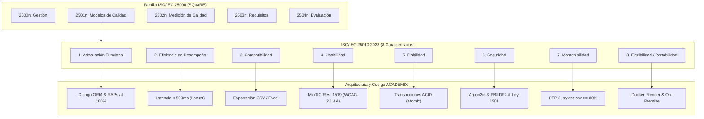
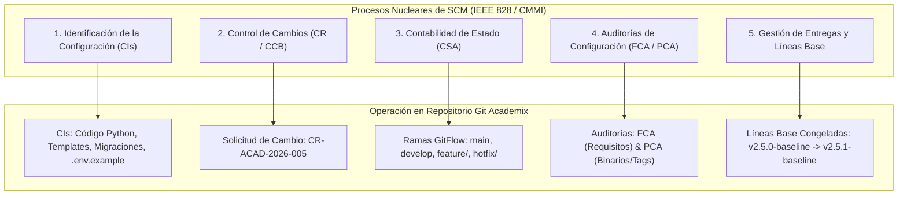

# INFORME TÉCNICO: MARCO CONCEPTUAL DE CALIDAD DE SOFTWARE Y GESTIÓN DE CONFIGURACIÓN (SCM)
## Investigación Normativa Exhaustiva: ISO/IEC 25010, IEEE 730, IEEE 828, CMMI y Relación con la Arquitectura de ACADEMIX

**Programa de Formación:** Tecnología en Análisis y Desarrollo de Software (ADSO)  
**Institución:** Servicio Nacional de Aprendizaje (SENA) — Centro de Formación en Tecnologías de la Información  
**Ficha de Caracterización:** 3173430  
**Proyecto Formativo:** Plataforma Web Integral de Gestión Académica y Control Escolar ACADEMIX  
**Fase de Formación:** Fase 1 — Investigación y Marco Conceptual (Trabajo Autónomo y Colaborativo)  
**Versión del Documento:** 1.0 Oficial  
**Fecha:** Noviembre de 2026  
**Autores:** Equipo de Desarrollo de Software y Aseguramiento de Calidad — Academix  

---

## TABLA DE CONTENIDO

1. [Introducción y Objetivos de Aprendizaje](#1-introducción-y-objetivos-de-aprendizaje)
   - 1.1 Objetivo General
   - 1.2 Objetivos Específicos
2. [Pilar 1: Modelo de Calidad del Producto de Software (ISO/IEC 25010)](#2-pilar-1-modelo-de-calidad-del-producto-de-software-isoiec-25010)
   - 2.1 La Familia de Normas ISO/IEC 25000 (SQuaRE) y Evolución a ISO/IEC 25010:2023
   - 2.2 Análisis Exhaustivo de las 8 Características y Subcaracterísticas de Calidad
   - 2.3 Matriz de Relación: Características ISO 25010 vs. Métricas Cuantitativas en el Código y Arquitectura de Academix
   - 2.4 Calidad Interna, Calidad Externa y Calidad en Uso (ISO/IEC 25019)
3. [Pilar 2: Aseguramiento de la Calidad del Software (SQA) y Normas IEEE](#3-pilar-2-aseguramiento-de-la-calidad-del-software-sqa-y-normas-ieee)
   - 3.1 Fundamentos y Enfoque Preventivo del Estándar IEEE 730
   - 3.2 Estructura y Contenido Obligatorio de un Plan de Calidad de Software (SQAP)
   - 3.3 Articulación de IEEE 730 con Metodologías Ágiles (Scrum, DoD, DoR) y DevOps/DevSecOps
   - 3.4 Procedimiento de Acciones Correctivas y Preventivas (CAPA)
4. [Pilar 3: Gestión de la Configuración del Software (SCM)](#4-pilar-3-gestión-de-la-configuración-del-software-scm)
   - 4.1 Definición y Procesos Nucleares de SCM según el Estándar IEEE 828-2012
   - 4.2 Enfoque de Gestión de la Configuración según CMMI-DEV (Área de Proceso CM)
   - 4.3 Control de Versiones: Modelos, Estrategia de Ramificación GitFlow y Commits Semánticos
   - 4.4 El Proceso Formal de Control de Cambios (CR / RFC, CCB y Rollback)
   - 4.5 Gestión de Líneas Base (Baselines) y Auditorías de Configuración (FCA y PCA)
   - 4.6 Contabilidad del Estado de la Configuración (CSA)
5. [Pilar 4: Marco Regulatorio y Entes de Calidad en Colombia (Actualizado 2026)](#5-pilar-4-marco-regulatorio-y-entes-de-calidad-en-colombia-actualizado-2026)
   - 5.1 ICONTEC (Normas Técnicas Colombianas NTC-ISO/IEC 25010, 12207 y 27001)
   - 5.2 MinTIC (Gobierno Digital y Resolución 1519 de 2020 de Accesibilidad Web WCAG 2.1 AA)
   - 5.3 Superintendencia de Industria y Comercio - SIC (Ley 1581 de 2012 y Datos de Menores NNA)
   - 5.4 colCERT / CSIRT de Gobierno (Mitigación OWASP Top 10 y Ciberseguridad)
   - 5.5 SENA (Norma Sectorial de Competencia Laboral 220501096)
6. [Conclusiones](#6-conclusiones)
7. [Referencias Bibliográficas (Norma APA 7.ª Edición)](#7-referencias-bibliográficas-norma-apa-7ª-edición)

---

# 1. INTRODUCCIÓN Y OBJETIVOS DE APRENDIZAJE

En la ingeniería de software profesional, la calidad y la gestión de configuración no son aditamentos secundarios ni pruebas accidentales ejecutadas al final de la codificación; son disciplinas rigurosas, preventivas y estructuradas que gobiernan la totalidad del ciclo de vida del software. Cuando un sistema de información administra el control escolar, la matrícula, la convivencia y las calificaciones oficiales de cientos de instituciones educativas —como es el caso de la plataforma **ACADEMIX**—, la ausencia de estándares de calidad y control de cambios deriva inexorablemente en corrupción de datos, brechas de seguridad legalmente sancionables, pérdida de trazabilidad y degradación del rendimiento.

El presente informe técnico constituye la investigación profunda e integral de la **Fase 1 (Investigación y Marco Conceptual)** orientada a la ingeniería de software, articulando:
1. El modelo jerárquico de calidad de producto bajo **ISO/IEC 25010:2023** y su mapeo cuantitativo directo sobre el código y la arquitectura de Academix.
2. Los fundamentos del Aseguramiento de Calidad del Software (**SQA**) gobernados por la norma **IEEE 730**, detallando la anatomía de un Plan de Calidad (SQAP) formal.
3. Los procesos de Gestión de Configuración del Software (**SCM**) basados en el estándar **IEEE 828-2012** y el modelo de madurez **CMMI-DEV** (Área de Proceso CM), abarcando control de versiones, gobernanza de líneas base y control de cambios.
4. El ecosistema normativo y legal colombiano actualizado a 2026 (**ICONTEC, MinTIC, SIC, colCERT y SENA**).

## 1.1 Objetivo General
Investigar, documentar y seleccionar los marcos normativos internacionales y nacionales de calidad de software (ISO/IEC 25010, IEEE 730, IEEE 828, CMMI y regulación colombiana), estableciendo las bases conceptuales, metodológicas y cuantitativas que regirán la arquitectura, el código fuente y la gestión de configuración de la plataforma de software Academix.

## 1.2 Objetivos Específicos
1. Investigar exhaustivamente las **8 características primarias** y las subcaracterísticas de la norma **ISO/IEC 25010:2023 (SQuaRE)**, diferenciando calidad interna, externa y calidad en uso.
2. Diseñar la **Matriz de Mapeo Cuantitativo** que vincule cada característica de calidad con fórmulas matemáticas, umbrales de aceptación numéricos y componentes concretos del código Python/Django y la base de datos de Academix.
3. Analizar la norma **IEEE 730-2014**, desglosando los componentes obligatorios que estructuran un Plan de Aseguramiento de Calidad del Software (**SQAP**) y su articulación con flujos ágiles y CI/CD.
4. Investigar los procesos de control de versiones, comités de control de cambios (CCB), auditorías de configuración y líneas base gobernados por **IEEE 828-2012** y las prácticas específicas de **CMMI-DEV**.
5. Contextualizar el marco regulatorio colombiano de TI: normas técnicas del **ICONTEC**, directrices de accesibilidad web de **MinTIC (Res. 1519 de 2020 / WCAG 2.1 AA)**, y el régimen de protección de datos de menores de la **SIC (Ley 1581 de 2012)**.

---

# 2. PILAR 1: MODELO DE CALIDAD DEL PRODUCTO DE SOFTWARE (ISO/IEC 25010)



## 2.1 La Familia de Normas ISO/IEC 25000 (SQuaRE) y Evolución a ISO/IEC 25010:2023
La serie **ISO/IEC 25000**, conocida como **SQuaRE** (*Systems and software Quality Requirements and Evaluation*), sustituyó formalmente a las normas ISO/IEC 9126 (evaluación de producto) e ISO/IEC 14598 (proceso de evaluación). SQuaRE unifica la terminología y estructura la evaluación en cinco divisiones:
1. **ISO/IEC 2500n - Gestión de Calidad:** Define directrices y modelos de ciclo de vida.
2. **ISO/IEC 2501n - Modelos de Calidad:** Contiene el modelo de calidad de producto de software (**ISO/IEC 25010**) y el modelo de calidad en uso (**ISO/IEC 25019**).
3. **ISO/IEC 2502n - Medición de Calidad:** Catálogo internacional de métricas matemáticas cuantitativas (**ISO/IEC 25023**).
4. **ISO/IEC 2503n - Requisitos de Calidad:** Guías para la especificación de Requerimientos No Funcionales (RNF).
5. **ISO/IEC 2504n - Evaluación de Calidad:** Procesos de auditoría y certificación independiente.

### Evolución a ISO/IEC 25010:2023
En la revisión internacional publicada en 2023:
- La portabilidad se transforma en **Flexibilidad (*Safety & Flexibility*)**, integrando la resiliencia en la nube y la escalabilidad dinámica.
- La accesibilidad se expande formalmente hacia la **Inclusión**, garantizando que el software pueda ser operado por cualquier persona con capacidades diversas.
- Se fortalece la relación con la norma **ISO/IEC 25012** (Calidad de Datos), asegurando la exactitud sintáctica y semántica de las bases de datos.

---

## 2.2 Análisis Exhaustivo de las 8 Características y Subcaracterísticas de Calidad

| Característica Primaria | Definición Técnica Formal | Subcaracterísticas Asociadas |
| :--- | :--- | :--- |
| **1. Adecuación Funcional** | Capacidad del producto de software para proporcionar funciones que satisfacen las necesidades declaradas e implícitas bajo condiciones especificadas. | • **Completitud Funcional:** Grado en que el conjunto de funciones cubre todas las tareas declaradas.<br>• **Exactitud Funcional:** Capacidad de proporcionar resultados con la precisión necesaria.<br>• **Pertinencia Funcional:** Grado en que las funciones facilitan el logro de tareas específicas. |
| **2. Eficiencia de Desempeño** | Rendimiento del software relativo a la cantidad de recursos consumidos en condiciones determinadas. | • **Comportamiento Temporal:** Tiempos de respuesta y procesamiento (latencia/TTFB).<br>• **Utilización de Recursos:** Cantidades y tipos de recursos utilizados (CPU, RAM, disco).<br>• **Capacidad:** Límites máximos de peticiones concurrentes y almacenamiento. |
| **3. Compatibilidad** | Capacidad de dos o más sistemas de intercambiar información y ejecutar funciones compartiendo el mismo entorno de hardware o software. | • **Coexistencia:** Capacidad de compartir un entorno común sin impacto adverso mutuo.<br>• **Interoperabilidad:** Grado en que dos o más sistemas pueden intercambiar y utilizar información útil. |
| **4. Usabilidad** | Grado en que el software puede ser entendido, aprendido, usado y resultar atractivo para los usuarios objetivo. | • **Reconocimiento de Idoneidad:** Facilidad con que los usuarios comprenden la utilidad del software.<br>• **Facilidad de Aprendizaje:** Esfuerzo mental requerido para dominar las funciones.<br>• **Operabilidad:** Facilidad de operación y control de la interfaz.<br>• **Protección contra Errores:** Grado en que el sistema previene que el usuario cometa equivocaciones.<br>• **Estética:** Grado en que la interfaz visual resulta placentera.<br>• **Accesibilidad / Inclusión:** Facilidad de uso para personas con capacidades diversas. |
| **5. Fiabilidad** | Capacidad del sistema para desempeñar funciones especificadas bajo condiciones dadas por un periodo de tiempo determinado. | • **Madurez:** Grado en que el sistema satisface necesidades de fiabilidad bajo operación normal.<br>• **Disponibilidad:** Porcentaje de tiempo en que el sistema está operacional y accesible.<br>• **Tolerancia a Fallos:** Capacidad de operar adecuadamente pese a fallos de hardware o software.<br>• **Recuperabilidad:** Capacidad de recuperar datos afectados y reanudar el estado deseado. |
| **6. Seguridad** | Grado de protección de información y datos para que personas o sistemas no autorizados no puedan acceder ni modificarlos. | • **Confidencialidad:** Asegura que los datos solo sean accesibles a personal autorizado.<br>• **Integridad:** Grado en que el sistema previene alteraciones no autorizadas.<br>• **No Repudio:** Capacidad de demostrar la ocurrencia de una acción o evento de forma irrefutable.<br>• **Responsabilidad (Trazabilidad):** Capacidad de rastrear las acciones de un usuario hacia su identidad.<br>• **Autenticidad:** Capacidad de validar la identidad declarada de un usuario o entidad. |
| **7. Mantenibilidad** | Efectividad y eficiencia con que el producto puede ser modificado por los desarrolladores y mantenedores. | • **Modularidad:** Grado en que el software se compone de módulos discretos e independientes.<br>• **Reusabilidad:** Capacidad de un activo de ser utilizado en más de un componente.<br>• **Analizabilidad:** Facilidad para evaluar el impacto de un cambio o diagnosticar defectos.<br>• **Modificabilidad:** Grado en que el software puede ser modificado sin introducir defectos.<br>• **Testabilidad:** Eficacia con que se pueden establecer criterios de prueba y ejecutarlos. |
| **8. Flexibilidad / Portabilidad** | Capacidad del sistema para adaptarse a diferentes entornos de hardware, software, red u operativos. | • **Adaptabilidad:** Facilidad para adaptarse a diferentes entornos sin aplicar acciones distintas a las previstas.<br>• **Facilidad de Instalación:** Grado en que el software puede ser instalado o desinstalado exitosamente.<br>• **Facilidad de Sustitución:** Capacidad del software de sustituir a otro producto para el mismo propósito. |

---

## 2.3 Matriz de Relación: Características ISO 25010 vs. Métricas Cuantitativas en el Código y Arquitectura de Academix

La calidad en Academix se aterriza en métricas formalizadas y verificables:

```
+----------------------------------------------------------------------------------------------------+
|                         MATRIZ DE RELACIÓN DE CALIDAD: ISO 25010 VS. ACADEMIX                      |
+----------------------------------------------------------------------------------------------------+
```

| Característica ISO 25010 | Subcaracterística | Métrica Formal y Fórmula Matemática | Componente Concreto en Academix | Herramienta de Medición | Umbral de Aceptación Numérico |
| :--- | :--- | :--- | :--- | :--- | :--- |
| **Adecuación Funcional** | **Exactitud Funcional** | $$E = \frac{N_{\text{calc\_exactos}}}{N_{\text{totales}}} \times 100$$ | Cálculo del promedio ponderado de notas según RAPs en `apps.grades.services`. | `pytest` / Test Cases con decimales periódicos. | **100.00% de exactitud matemática.** Cero discrepancias en actas. |
| **Adecuación Funcional** | **Completitud Funcional** | $$C = \frac{R_{\text{importados\_exitosos}}}{R_{\text{validos\_archivo}}} \times 100$$ | Procesamiento masivo de matrículas en `apps.students.views.bulk_upload`. | Pruebas de integración con datasets de 500 registros. | **100% de registros válidos procesados e insertados.** |
| **Eficiencia de Desempeño** | **Comportamiento Temporal** | $$T_{\text{medio}} = \frac{1}{n} \sum_{i=1}^{n} T_i \le 500\text{ ms}$$<br>Percentil 95 ($P_{95}$) $\le 800\text{ ms}$. | Tiempo de respuesta del servidor (TTFB) en Dashboard y listados de calificaciones. | `Locust` (Simulación de 100 usuarios docentes concurrentes). | **$T_{\text{medio}} \le 500\text{ ms}$ y $P_{95} \le 800\text{ ms}$.** Tasa errores $< 0.1\%$. |
| **Eficiencia de Desempeño** | **Utilización de Recursos** | $$U_{\text{CPU}} \le 60\% \quad;\quad U_{\text{RAM}} \le 1.5\text{ GB}$$ | Servidor WSGI Gunicorn + Nginx + PostgreSQL bajo carga continua. | Monitoreo de contenedores Docker / métricas de Render. | **Consumo de memoria RAM $\le 1.5\text{ GB}$ bajo carga pico.** |
| **Compatibilidad** | **Interoperabilidad** | Tasa de conformidad en importación y exportación de datos en formatos universales (CSV, XLSX, PDF). | Módulos de reportes y carga masiva (`apps.reports` y `apps.students`). | Validadores de sintaxis RFC 4180 (CSV) y OpenXML (XLSX). | **100% de compatibilidad con suites de oficina (Excel, LibreOffice).** |
| **Usabilidad** | **Accesibilidad (MinTIC)** | Puntuación de Accesibilidad WCAG 2.1 nivel AA y contraste cromático $\ge 4.5:1$. | Plantillas HTML5, [login.html](file:///C:/Academix/templates/accounts/login.html) y formularios de calificaciones. | `Google Lighthouse CI` y extensión de auditoría `axe DevTools`. | **Puntaje de Accesibilidad $\ge 90/100$ en Lighthouse.** |
| **Fiabilidad** | **Tolerancia a Fallos** | Tasa de inconsistencias relacionales tras interrupción forzada (`kill -9`) en escrituras múltiples. | Transacciones atómicas encapsuladas en `@transaction.atomic` en notas y matrículas. | Pruebas de caos e inyección forzada de fallos en PostgreSQL. | **0 registros huérfanos o corruptos.** Rollback automático al 100%. |
| **Seguridad** | **Confidencialidad** | $$S_{\text{pwd}} = \frac{U_{\text{hash\_robusto}}}{U_{\text{totales}}} \times 100$$ | Almacenamiento criptográfico de credenciales en `accounts_customuser`. | Escáner estático `Bandit` e inspección de esquemas de BD. | **100% de contraseñas con hashing Argon2id o PBKDF2.** Cero texto plano. |
| **Seguridad** | **Integridad y RBAC** | $$I_{\text{RBAC}} = 1 - \left( \frac{V_{\text{no\_autorizados}}}{P_{\text{intentos\_pentesting}}} \right)$$ | Matriz de permisos de 5 roles (Rector, Coordinador, Docente, Estudiante, Acudiente). | `OWASP ZAP` (Pruebas DAST simulando accesos con cookies ajenas). | **100% de rutas protegidas.** Cero accesos indebidos (`HTTP 403 / 302`). |
| **Mantenibilidad** | **Capacidad de Prueba (Testabilidad)** | $$\text{Cov} = \frac{L_{\text{ejecutadas\_tests}}}{L_{\text{totales\_codigo}}} \times 100 \ge 80\%$$ | Suite automatizada de pruebas unitarias y de integración sobre lógica de negocio. | `pytest-cov` / `coverage.py` integrado a Git. | **Cobertura global de código $\ge 80\%$.** |
| **Mantenibilidad** | **Modularidad y Complejidad** | Complejidad Ciclomática de McCabe:$$v(G) = E - N + 2P \le 10$$ | Funciones y métodos de negocio en `services.py`, `views.py` y `models.py`. | Herramienta de análisis estático `radon` (`radon cc apps/ -a`). | **$v(G) \le 10$ por función.** Cero métodos con complejidad $> 12$. |
| **Flexibilidad / Portabilidad** | **Adaptabilidad** | Tiempo medio de despliegue y puesta en marcha en un entorno nuevo (MTTD). | Contenerización Docker, `render.yaml` y scripts locales [iniciar_servidor_red.bat](file:///C:/Academix/iniciar_servidor_red.bat). | Pruebas de despliegue automatizado en entornos limpios. | **Despliegue operativo completo en menos de 10 minutos.** |

---

## 2.4 Calidad Interna, Calidad Externa y Calidad en Uso (ISO/IEC 25019)
Es fundamental para el equipo distinguir los tres niveles de evaluación que estipula SQuaRE:
- **Calidad Interna:** Se evalúa sobre los productos intermedios y estáticos del desarrollo: código fuente Python, arquitectura de modelos, docstrings, complejidad ciclomática y ausencia de malas prácticas (*code smells*).
- **Calidad Externa:** Se evalúa midiendo el comportamiento del software dinámico en ejecución: tiempos de respuesta HTTP, consumo de memoria del proceso Gunicorn, resistencia frente a ataques de inyección y tolerancia a fallos.
- **Calidad en Uso (ISO/IEC 25019 / 25022):** Evalúa el impacto real del software en el entorno pedagógico de la institución educativa a través de cinco atributos:
  1. *Eficacia:* Exactitud con la que docentes y directivos cierran el periodo académico sin errores en boletines.
  2. *Eficiencia:* Cantidad de horas ahorradas en secretaría en la consolidación de notas frente al método en papel.
  3. *Satisfacción:* Percepción de agrado, confianza y confort de padres y docentes con la plataforma.
  4. *Ausencia de Riesgo:* Mitigación de riesgos legales (sanciones SIC por datos de menores) y riesgos pedagógicos.
  5. *Cobertura de Contexto:* Funcionamiento uniforme tanto en computadores de escritorio de secretaría como en teléfonos celulares de familias con conexiones variables de red.

---

# 3. PILAR 2: ASEGURAMIENTO DE LA CALIDAD DEL SOFTWARE (SQA) Y NORMAS IEEE

```
+----------------------------------------------------------------------------------------------------+
|                       MODELO DE ASEGURAMIENTO DE CALIDAD SEGÚN IEEE 730                            |
+----------------------------------------------------------------------------------------------------+
```

## 3.1 Fundamentos y Enfoque Preventivo del Estándar IEEE 730
El estándar **IEEE 730** (*Standard for Software Quality Assurance Processes*) establece los requerimientos para iniciar, planificar, ejecutar y evaluar los procesos de **Aseguramiento de Calidad del Software (SQA)**. A diferencia del testing de software tradicional —que actúa de manera reactiva al final de la construcción buscando defectos en el producto terminado—, el SQA es una disciplina **preventiva orientada a los procesos**:
- Garantiza que los procesos de desarrollo, estándares de codificación, revisiones por pares y pruebas formales se definan y se cumplan a lo largo de todo el ciclo de vida.
- Otorga al equipo auditor la autoridad formal para detener un despliegue si los criterios de aceptación no se satisfacen.

---

## 3.2 Estructura y Contenido Obligatorio de un Plan de Calidad de Software (SQAP)
Bajo la norma IEEE 730, un **Plan de Aseguramiento de Calidad del Software (SQAP - *Software Quality Assurance Plan*)** formal debe estructurarse obligatoriamente en las siguientes diez secciones operativas:

```
┌────────────────────────────────────────────────────────────────────────┐
│             ESTRUCTURA DEL PLAN DE CALIDAD DE SOFTWARE (SQAP)          │
│                              (IEEE 730)                                │
├────────────────────────────────────────────────────────────────────────┤
│ 1. Propósito y Alcance del Plan                                        │
│ 2. Documentos de Referencia (Normas y Políticas Institucionales)       │
│ 3. Gestión y Organización del SQA (Roles, Independencia y Autoridad)   │
│ 4. Actividades y Procesos de SQA (Revisiones Técnicas y Auditorías)    │
│ 5. Estándares, Prácticas, Convenciones y Métricas (PEP 8, DoD)         │
│ 6. Gestión de Pruebas de Software (Plan de Verificación y Validación) │
│ 7. Notificación de Problemas y Acciones Correctivas (CAPA)             │
│ 8. Herramientas, Técnicas y Metodologías de Apoyo (Linters, SAST, DAST)│
│ 9. Control de Medios, Proveedores y Seguridad de la Información        │
│ 10. Registros de Calidad, Trazabilidad y Retención Documental         │
└────────────────────────────────────────────────────────────────────────┘
```

1. **Propósito y Alcance:** Define los productos de software cubiertos por el plan, las etapas del ciclo de vida involucradas y las metas de calidad cuantificables.
2. **Documentos de Referencia:** Inventario de normas técnicas aplicables (ISO 25010, IEEE 828, Ley 1581 de 2012, Resoluciones MinTIC).
3. **Gestión y Organización:** Define la estructura organizacional del equipo. Establece el principio de **independencia del auditor de calidad** frente a los desarrolladores para asegurar evaluaciones imparciales, otorgándole autoridad de veto sobre despliegues no conformes.
4. **Actividades y Procesos de SQA:** Calendario y metodología de las revisiones formales:
   - *Revisiones de Requisitos de Software (SRR):* Validación de requerimientos funcionales y no funcionales.
   - *Revisiones de Diseño Arquitectónico (PDR/CDR):* Inspección del modelo relacional de datos y desacoplamiento de micro-apps Django.
   - *Inspecciones de Código (Code Reviews):* Revisiones paritarias obligatorias previas a cada Merge en Git.
   - *Auditorías de Configuración (FCA y PCA):* Auditoría de configuración funcional y física.
5. **Estándares, Prácticas, Convenciones y Métricas:**
   - Estándar de codificación Python (**PEP 8**).
   - Estándar de mensajes de commit (**Conventional Commits**).
   - Métricas umbral de aceptación: cobertura de pruebas unitarias $\ge 80\%$, complejidad ciclomática de McCabe $v(G) \le 10$.
6. **Gestión de Pruebas de Software (V&V - Verificación y Validación):** Matriz de pruebas unitarias (`pytest`), pruebas de integración de endpoints, pruebas de carga (`Locust`) y pruebas de penetración web (`OWASP ZAP`).
7. **Reporte de Problemas y Acciones Correctivas (CAPA):** Procedimiento estandarizado para tipificar defectos, analizar causas raíz mediante diagramas de Ishikawa / 5 Porqués y verificar el cierre de las soluciones.
8. **Herramientas y Metodologías de Apoyo:** Entornos de desarrollo, linters automatizados (`flake8`, `black`), analizadores de seguridad (`Bandit`) y motores de CI/CD.
9. **Control de Medios y Seguridad:** Mecanismos de protección para repositorios de código, copias de respaldo (*backups* PostgreSQL bajo la regla 3-2-1) y control de acceso a entornos de producción.
10. **Registros de Calidad:** Bitácoras de auditoría, actas de reunión del Comité de Control de Cambios (CCB), listas de chequeo firmadas y reportes de cobertura conservados como evidencia auditable.

---

## 3.3 Articulación de IEEE 730 con Metodologías Ágiles (Scrum, DoD, DoR) y DevOps/DevSecOps
En el paradigma contemporáneo, el aseguramiento de calidad según IEEE 730 no opera como una burocracia rígida de cascada, sino que se automatiza y distribuye dentro de los sprints y pipelines continuos:
- **Definition of Ready (DoR):** Una historia de usuario de Academix (ej. *Cierre extemporáneo de periodo académico*) solo ingresa al Sprint Backlog si cuenta con criterios de aceptación de calidad especificados y análisis previo de riesgos de privacidad (Ley 1581).
- **Definition of Done (DoD):** Una tarea solo se marca como finalizada si cumple la lista de control de SQA:
  - [x] Código probado con pruebas unitarias pasando al 100%.
  - [x] Cobertura de pruebas igual o superior al 80%.
  - [x] Análisis de seguridad estático (SAST con Bandit) sin vulnerabilidades críticas.
  - [x] Revisión de código por pares (*Peer Code Review*) aprobada en el Pull Request.
  - [x] Manual técnico y diccionario de datos actualizados.
- **Enfoque DevSecOps:** Integración de herramientas de análisis en el pipeline de Git: cada `git push` desencadena la ejecución automática de linters, escáner de dependencias desactualizadas (`pip-audit`) y pruebas unitarias antes de admitir la fusión a la rama principal.

---

## 3.4 Procedimiento de Acciones Correctivas y Preventivas (CAPA)
El procedimiento CAPA estructurado bajo IEEE 730 e ISO 9001/ISO 19011 consta de cinco pasos metódicos:
1. **Identificación y Registro:** Documentación formal del defecto o no conformidad con evidencia objetiva (código de error, traza de log, captura de pantalla).
2. **Evaluación de Impacto:** Calificación de la severidad (Crítica, Mayor, Menor) y riesgo asociado.
3. **Análisis de Causa Raíz:** Aplicación sistemática de técnicas de ingeniería: **Diagrama de Ishikawa (Espina de Pescado)** y el método de los **5 Porqués** para evitar parches superficiales y atacar el problema estructural.
4. **Plan de Acción:** Asignación de medidas técnicas correctivas (para eliminar la no conformidad actual) y preventivas (para evitar su recurrencia), con responsable y fecha límite de entrega.
5. **Verificación de Eficacia:** Re-auditoría técnica para comprobar que la solución subsanó el defecto sin generar efectos colaterales de regresión en otros módulos.

---

# 4. PILAR 3: GESTIÓN DE LA CONFIGURACIÓN DEL SOFTWARE (SCM)



## 4.1 Definición y Procesos Nucleares de SCM según el Estándar IEEE 828-2012
El estándar **IEEE 828-2012** (*Standard for Configuration Management in Systems and Software Engineering*) define la Gestión de Configuración del Software (SCM) como la disciplina que aplica dirección técnica y administrativa para:
1. **Identificar y Definir los Ítems de Configuración (CI):** Seleccionar qué elementos del software están sujetos a control de versiones formal (código fuente Python, plantillas HTML, scripts de migración `migrations/`, esquemas SQL, dependencias `requirements.txt`, Dockerfiles y manuales técnicos).
2. **Controlar los Cambios:** Establecer un mecanismo sistemático para solicitar, evaluar, aprobar y registrar modificaciones sobre las líneas base.
3. **Registrar y Reportar el Estado de la Configuración (CSA):** Mantener un historial completo y auditable de las versiones y solicitudes de cambio.
4. **Auditar la Configuración:** Verificar que los productos construidos cumplan con los requerimientos funcionales y físicos acordados.
5. **Gestionar la Entrega y Despliegue (*Release Management*):** Controlar la compilación, empaquetado, etiquetado y distribución formal del software a los entornos de producción.

---

## 4.2 Enfoque de Gestión de la Configuración según CMMI-DEV (Área de Proceso CM)
En el modelo de madurez **CMMI-DEV (Capability Maturity Model Integration)**, el Área de Proceso de **Gestión de la Configuración (CM - *Configuration Management*)** pertenece a la categoría de soporte y se organiza en tres Metas Específicas (SG - *Specific Goals*) y siete Prácticas Específicas (SP - *Specific Practices*):

```
+----------------------------------------------------------------------------------------------------+
|                         GESTIÓN DE CONFIGURACIÓN SEGÚN CMMI-DEV (ÁREA CM)                          |
+----------------------------------------------------------------------------------------------------+
```

| Meta Específica (SG) | Práctica Específica (SP) | Descripción e Implementación en el Proyecto Academix |
| :--- | :--- | :--- |
| **SG 1: Establecer Líneas Base**<br>*Establecer y mantener la integridad de los productos de trabajo utilizando control de versiones y líneas base.* | **SP 1.1 Identificar Ítems de Configuración (CIs)** | Definir formalmente los CIs: código fuente en micro-apps Django, migraciones relacionales, archivos de configuración de entorno (`.env.example`), plantillas HTML y manuales técnicos en Markdown. |
| | **SP 1.2 Establecer un Sistema de Gestión de Configuración** | Implementación de repositorio centralizado en Git (GitHub/GitLab) con control de acceso por llaves SSH y ramas protegidas. |
| | **SP 1.3 Crear o Liberar Líneas Base** | Congelamiento de versiones estables mediante etiquetas criptográficas firmadas en Git (ej. `v2.5.0-baseline` y `v2.5.1-baseline`). |
| **SG 2: Seguir y Controlar los Cambios**<br>*Seguir y controlar los cambios a los productos de trabajo bajo gestión de configuración.* | **SP 2.1 Seguir las Peticiones de Cambio** | Registro formal de cada requerimiento o corrección a través de formatos unificados de Solicitud de Cambio (**Change Requests - CR / RFC**) en el sistema de tickets/issues. |
| | **SP 2.2 Controlar los Ítems de Configuración** | Toda modificación debe asociarse a una rama de trabajo temática (`feature/` o `fix/`) originada desde la línea base aprobada, prohibiendo commits directos a `main`. |
| **SG 3: Establecer la Integridad**<br>*Establecer y mantener la integridad de las líneas base a lo largo del ciclo de vida.* | **SP 3.1 Establecer Registros de Estado de la Configuración (CSA)** | Mantener la bitácora histórica que documenta qué cambios fueron aprobados por el CCB, qué commit los implementó y en qué versión se desplegaron. |
| | **SP 3.2 Realizar Auditorías de Configuración** | Ejecución periódica de auditorías funcionales (FCA) y físicas (PCA) antes de cada liberación de versión a producción. |

---

## 4.3 Control de Versiones: Modelos, Estrategia de Ramificación GitFlow y Commits Semánticos

### 4.3.1 Modelos de Control de Versiones
- **Centralizado (CVCS - ej. SVN):** Un único servidor aloja el repositorio; los desarrolladores dependen de la conexión permanente para versionar.
- **Distribuido (DVCS - ej. Git):** Cada desarrollador posee una réplica local completa del repositorio con su propio historial y capacidad de commit local, facilitando el trabajo descentralizado y seguro adoptado por Academix.

### 4.3.2 Estrategia de Ramas GitFlow Adaptada
Para el desarrollo de Academix se adopta una arquitectura de ramificación gobernada:

```
[ Rama main ] ──(v2.5.0-baseline)─────────────────────────(v2.5.1-baseline)──► Producción
                      │                                        ▲
                      │ (Branching)                            │ (Pull Request #143 & Merge --no-ff)
                      ▼                                        │
[ Rama feature/CR-005 ] ── commit (feat) ── commit (fix/a11y) ─┘ Desarrollo Aislado
```

- **`main`:** Rama productiva inmutable. Solo contiene código probado y etiquetado con versiones estables.
- **`develop`:** Rama de integración continua donde convergen las funcionalidades aprobadas.
- **`feature/nombre-cambio`:** Ramas temporales creadas para implementar una Solicitud de Cambio específica (ej. `feature/CR-005-login-ratelimit-aria`).
- **`hotfix/nombre-parche`:** Ramas de corrección de emergencia desplegadas directamente sobre `main`.

### 4.3.3 Estándar de Commits Semánticos (Conventional Commits)
Los commits deben seguir la convención internacional `tipo(alcance): descripción`:
- `feat(accounts): implementar limitador de tasa de 5 intentos/min en login (CR-005)`
- `fix(a11y): anadir atributos role=alert y aria-live en login.html (CR-005)`
- `test(grades): anadir pruebas unitarias de ponderacion de RAPs con pytest`
- `docs(quality): actualizar informe tecnico de auditoria y manuales oficiales`

---

## 4.4 El Proceso Formal de Control de Cambios (CR / RFC, CCB y Rollback)

El control de cambios es el proceso que evita el caos de modificaciones arbitrarias no probadas en el software.

```
┌────────────────────────────────────────────────────────────────────────┐
│                   CICLO DE VIDA DEL CONTROL DE CAMBIOS                 │
└───────────────────────────────────┬────────────────────────────────────┘
                                    │
                                    ▼
                [ 1. Solicitud de Cambio (CR / RFC) ]
                Registro formal de la necesidad o corrección
                                    │
                                    ▼
                [ 2. Análisis de Impacto Multidimensional ]
                Arquitectura, Base de Datos, UI, Seguridad y Costo
                                    │
                                    ▼
                [ 3. Comité de Control de Cambios (CCB) ]
                Evaluación: ¿Se aprueba, rechaza o aplaza?
                                    │
                 ┌──────────────────┴──────────────────┐
                 ▼                                     ▼
          [ APROBADO ]                           [ RECHAZADO ]
                 │                               Notificación y Cierre
                 ▼
       [ 4. Implementación Aislada ]
       Desarrollo en rama feature/ bajo GitFlow
                 │
                 ▼
       [ 5. Verificación & Code Review ]
       Checklist paritario de 15 ítems y pruebas unitarias
                 │
                 ▼
       [ 6. Fusión (Merge) & Nueva Línea Base ]
       Etiquetado formal y registro en bitácora CSA
```

1. **Solicitud de Cambio (Change Request - CR / Request For Change - RFC):** Formato estructurado que documenta el código del cambio, solicitante, descripción, justificación del negocio y nivel de riesgo estimado.
2. **Análisis de Impacto Técnico Multidimensional:** Evaluación obligatoria que analiza:
   - *Impacto en Base de Datos:* ¿Requiere migraciones relacionales? ¿Afecta registros históricos?
   - *Impacto Arquitectónico:* ¿Rompe el desacoplamiento de micro-apps? ¿Introduce dependencias circulares?
   - *Impacto en Seguridad y Privacidad:* ¿Cumple con la Ley 1581 de 2012 para menores de edad?
   - *Plan de Marcha Atrás (Rollback Plan):* Instrucciones técnicas paso a paso (scripts de migración en reversa, checkout de Git hacia la línea base previa y reinicio de servicios) para retornar al estado anterior en menos de 10 minutos si ocurre una falla imprevista en producción.
3. **Comité de Control de Cambios (CCB - *Change Control Board*):** Equipo colegiado integrado por el Líder Técnico de Desarrollo, el Responsable de SQA y el Representante del Cliente/Product Owner. Es la única entidad con autoridad para autorizar la apertura de una rama de cambio.

---

## 4.5 Gestión de Líneas Base (Baselines) y Auditorías de Configuración (FCA y PCA)

### 4.5.1 Concepto y Tipos de Líneas Base
Una **Línea Base (Baseline)** es una versión revisada formalmente y aprobada de uno o varios Ítems de Configuración que actúa como punto de partida fijo para desarrollos posteriores. En Academix se gestionan tres tipos de líneas base:
- **Línea Base de Requerimientos (Functional Baseline):** Matriz de Requerimientos de Software (SRS) aprobada por la institución escolar.
- **Línea Base de Diseño y Arquitectura (Design Baseline):** Esquema relacional de base de datos normalizado en 3FN y estructura de 15 micro-apps en Django.
- **Línea Base de Producto o Entrega (Product / Release Baseline):** Versión del software probada, desplegada en producción y congelada mediante una etiqueta de Git (ej. `v2.5.0-baseline` y `v2.5.1-baseline`).

### 4.5.2 Auditorías de Configuración según IEEE 828
Antes de congelar y liberar una nueva línea base a producción se ejecutan dos auditorías formales:
- **Auditoría de Configuración Funcional (FCA - *Functional Configuration Audit*):** Comprueba mediante pruebas automatizadas que el software cumple con la totalidad de los requerimientos funcionales y de rendimiento especificados en la Solicitud de Cambio.
- **Auditoría de Configuración Física (PCA - *Physical Configuration Audit*):** Comprueba que todos los Ítems de Configuración especificados (código, dependencias en `requirements.txt`, variables de entorno en `.env.example`, scripts de migración y documentación) existan físicamente en el repositorio bajo control de versiones y coincidan con el tag generado.

---

## 4.6 Contabilidad del Estado de la Configuración (CSA)
La **Contabilidad del Estado de la Configuración (CSA - *Configuration Status Accounting*)** es el registro continuo y auditable que responde en cualquier momento a las preguntas:
- ¿Qué cambios fueron solicitados y quién los autorizó?
- ¿Qué versión del software contiene una corrección específica?
- ¿Cuál es la diferencia exacta entre la Línea Base actual y la anterior?

En Academix, la bitácora CSA se alimenta automáticamente mediante las herramientas de Git (`git log --oneline --decorate --graph`), los metadatos de los Pull Requests y los registros formales de las Solicitudes de Cambio tramitadas ante el CCB.

---

# 5. PILAR 4: MARCO REGULATORIO Y ENTES DE CALIDAD EN COLOMBIA (ACTUALIZADO 2026)

```
               ┌────────────────────────────────────────────────────────┐
               │    ENTES REGULADORES DE CALIDAD Y TI EN COLOMBIA       │
               └───────────────────────────┬────────────────────────────┘
                                           │
         ┌──────────────────┬──────────────┴─────┬──────────────────┐
         ▼                  ▼                    ▼                  ▼
    [ ICONTEC ]         [ MinTIC ]            [ SIC ]        [ colCERT / CSIRT ]
   Normalización     Gobierno Digital     Datos Personales    Ciberseguridad y
    NTC-ISO 25010     Accesibilidad       Ley 1581 / NNA      Mitigación OWASP
    NTC-ISO 27001     Res. 1519 (AA)      RNBD Institucional  CONPES 3995
```

El desarrollo e implantación de software en el territorio colombiano exige el cumplimiento taxativo de un marco legal y técnico vinculante:

## 5.1 ICONTEC (Instituto Colombiano de Normas Técnicas y Certificación)
Organismo Nacional de Normalización de Colombia. A través de su Comité Técnico 181 (Ingeniería de Software y Sistemas de Información), homologa y adopta oficialmente los estándares internacionales como Normas Técnicas Colombianas (NTC):
- **NTC-ISO/IEC 25010:** Adopción oficial del modelo de calidad de producto software en Colombia. Es el referente exigido en pliegos de contratación pública y privada para auditar la conformidad de sistemas informáticos.
- **NTC-ISO/IEC 12207:** Procesos del ciclo de vida del software (adquisición, suministro, desarrollo, operación y mantenimiento).
- **NTC-ISO/IEC 27001:** Sistemas de Gestión de la Seguridad de la Información (SGSI), aplicable a centros de datos, bases de datos escolares y control de credenciales.
- **NTC 5906:** Gestión de la calidad de datos en tecnologías de la información.

## 5.2 MinTIC (Ministerio de Tecnologías de la Información y las Comunicaciones)
Entidad gubernamental rectora de las políticas tecnológicas en Colombia:
- **Política de Gobierno Digital (Decreto 1078 de 2015, modificado por Decreto 088 de 2022 y Resolución 460 de 2022):** Define los lineamientos de transformación digital, interoperabilidad de plataformas ciudadanas y servicios digitales para instituciones educativas públicas y mixtas.
- **Resolución 1519 de 2020 (Accesibilidad y Usabilidad Web):** Dicta directrices obligatorias de accesibilidad basadas en el estándar internacional **W3C WCAG 2.1 en nivel de conformidad AA**. Todo portal o software escolar debe garantizar:
  1. Contraste cromático adecuado ($\ge 4.5:1$ en texto estándar y $\ge 3:1$ en componentes gráficos).
  2. Navegación completa mediante teclado para personas con dificultades motrices.
  3. Atributos semánticos ARIA (`role="alert"`, `aria-live`, `aria-describedby`) para compatibilidad con lectores de pantalla utilizados por personas con discapacidad visual.
  4. Diseño adaptativo (*Responsive Web Design*) funcional en dispositivos móviles.

## 5.3 Superintendencia de Industria y Comercio (SIC) — Delegatura de Protección de Datos Personales
Autoridad nacional de control y vigilancia en materia de Habeas Data:
- **Ley Estatutaria 1581 de 2012 y Decreto 1377 de 2013:** Marco regulatorio general de protección de datos personales en Colombia.
- **Régimen Especial para Niños, Niñas y Adolescentes (NNA - Artículo 7 de la Ley 1581):** Establece una prohibición general para el tratamiento de datos de menores, admitiendo excepciones únicamente cuando se respete su interés superior y se cuente con la autorización previa, expresa e informada de sus padres o acudientes legales. En Academix, esto exige:
  1. Almacenamiento seguro de credenciales bajo algoritmos de derivación criptográfica robustos (**Argon2id, PBKDF2**). Cero almacenamiento en texto plano.
  2. Aislamiento estricto de historiales académicos, notas y sanciones convivenciales mediante Control de Acceso Basado en Roles (RBAC).
  3. Anonimización de datos en logs de auditoría y entornos de depuración.
  4. Obligación de inscripción de las bases de datos escolares en el **Registro Nacional de Bases de Datos (RNBD)** administrado por la SIC.

## 5.4 colCERT (Equipo de Respuesta a Incidentes Cibernéticos de Colombia) y CSIRT de Gobierno
Dependencias adscritas al Ministerio de Defensa y MinTIC responsables de la ciberseguridad nacional:
- Promueven la adopción obligatoria de defensas frente a las diez vulnerabilidades más críticas catalogadas por **OWASP (OWASP Top 10)**:
  - *A01: Broken Access Control (Control de acceso roto)* $\rightarrow$ Mitigado en Academix con decoradores `@login_required` y validación estricta de roles.
  - *A03: Injection (Inyecciones SQL)* $\rightarrow$ Mitigado mediante el uso exclusivo de consultas parametrizadas a través del ORM de Django.
  - *A07: Identification and Authentication Failures* $\rightarrow$ Mitigado mediante políticas de contraseñas robustas y rate-limiting en el endpoint de login.
- Dictan directrices alineadas con el documento **CONPES 3995 (Política Nacional de Confianza y Seguridad Digital)** para proteger las infraestructuras de información del sector educativo contra accesos no autorizados y fugas de datos.

## 5.5 SENA (Servicio Nacional de Aprendizaje)
Como entidad líder de la formación profesional integral en Colombia, rige las competencias técnicas del programa ADSO bajo la **Norma Sectorial de Competencia Laboral 220501096: Desarrollar el sistema informático según requisitos y diseño tecnológico**. El SENA audita que los proyectos formativos adopten la trazabilidad documental, la aplicación estricta de normas técnicas internacionales y la ejecución rigurosa de pruebas de calidad previas al egreso productivo.

---

# 6. CONCLUSIONES

1. **La Calidad como Disciplina Metódica y Cuantificable:** La aplicación integrada de la norma ISO/IEC 25010:2023 supera la visión intuitiva del desarrollo de software, suministrando una matriz matemática de métricas que permite auditar con precisión la exactitud funcional, el rendimiento concurrente, la seguridad criptográfica y la mantenibilidad de la plataforma Academix.
2. **Aseguramiento Preventivo de Procesos con IEEE 730:** El estándar IEEE 730 demuestra que el aseguramiento de calidad no es sinónimo de pruebas de última hora, sino una disciplina preventiva que formaliza la *Definition of Done (DoD)*, las revisiones por pares y los planes de acciones correctivas (CAPA) para erradicar las causas estructurales de las anomalías.
3. **Gobernanza de la Configuración con IEEE 828 y CMMI:** La gestión de configuración del software garantiza la soberanía técnica del código a través del flujo GitFlow, el trámite formal de solicitudes de cambio (CR/RFC) ante el Comité de Control de Cambios (CCB), el congelamiento de líneas base reproducibles y la contabilidad continua del estado (CSA).
4. **Cumplimiento Vinculante del Ecosistema Legal Colombiano:** El software escolar en Colombia opera bajo un marco legal estricto: la protección reforzada de datos de menores ante la **Superintendencia de Industria y Comercio (Ley 1581 de 2012)**, los estándares de accesibilidad e inclusión web de la **Resolución 1519 de 2020 de MinTIC** y la homologación técnica de **ICONTEC (NTC-ISO/IEC 25010)**, convirtiendo la calidad en un mandato ineludible de responsabilidad social e ingenieril.

---

# 7. REFERENCIAS BIBLIOGRÁFICAS (NORMA APA 7.ª EDICIÓN)

- CMMI Product Team. (2018). *CMMI for Development, Version 2.0 (CMMI-DEV v2.0)*. Pittsburgh, PA: Software Engineering Institute, Carnegie Mellon University.
- Congreso de la República de Colombia. (2012). *Ley Estatutaria 1581 de 2012, por la cual se dictan disposiciones generales para la protección de datos personales*. Diario Oficial No. 48.587.
- Consejo Nacional de Política Económica y Social [CONPES]. (2020). *Documento CONPES 3995: Política Nacional de Confianza y Seguridad Digital*. Bogotá: Departamento Nacional de Planeación.
- Instituto Colombiano de Normas Técnicas y Certificación [ICONTEC]. (2013). *Norma Técnica Colombiana NTC-ISO/IEC 25010: Requisitos de Calidad y Evaluación de Software (SQuaRE) - Modelos de Calidad de Sistemas y Software*. Bogotá: ICONTEC.
- Instituto Colombiano de Normas Técnicas y Certificación [ICONTEC]. (2018). *Norma Técnica Colombiana NTC-ISO/IEC 27001: Sistemas de Gestión de la Seguridad de la Información (SGSI)*. Bogotá: ICONTEC.
- International Organization for Standardization [ISO]. (2023). *ISO/IEC 25010:2023 Systems and software engineering — Systems and software Quality Requirements and Evaluation (SQuaRE) — Product quality model*. Ginebra: ISO.
- Institute of Electrical and Electronics Engineers [IEEE]. (2012). *IEEE Std 828-2012: IEEE Standard for Configuration Management in Systems and Software Engineering*. Nueva York: IEEE Computer Society.
- Institute of Electrical and Electronics Engineers [IEEE]. (2014). *IEEE Std 730-2014: IEEE Standard for Software Quality Assurance Processes*. Nueva York: IEEE Computer Society.
- Ministerio de Tecnologías de la Información y las Comunicaciones [MinTIC]. (2020). *Resolución 1519 de 2020: Directrices de Accesibilidad Web (WCAG 2.1 AA)*. Bogotá: MinTIC.
- Ministerio de Tecnologías de la Información y las Comunicaciones [MinTIC]. (2022). *Decreto 088 de 2022: Lineamientos Generales de la Política de Gobierno Digital*. Bogotá: MinTIC.
- OWASP Foundation. (2021). *OWASP Top 10: The Ten Most Critical Web Application Security Risks*. Open Web Application Security Project. https://owasp.org/Top10/
- Servicio Nacional de Aprendizaje [SENA]. (2024). *Norma Sectorial de Competencia Laboral 220501096: Desarrollar el sistema informático según requisitos y diseño tecnológico*. Dirección de Formación Profesional, Bogotá D.C.

